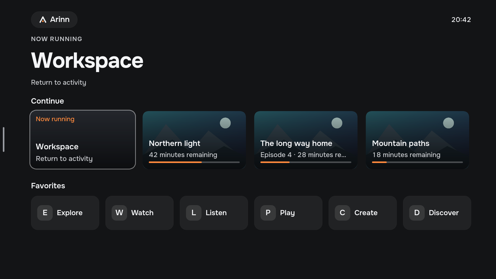
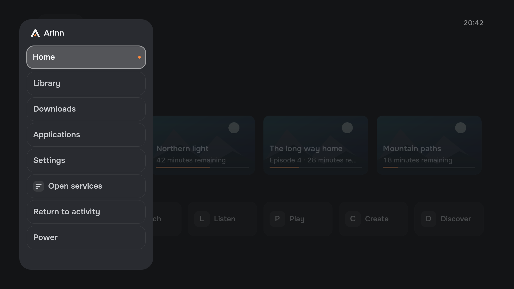
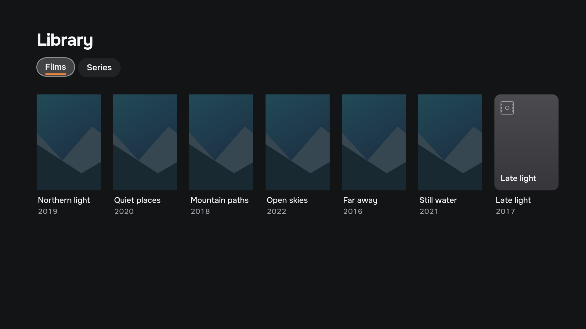
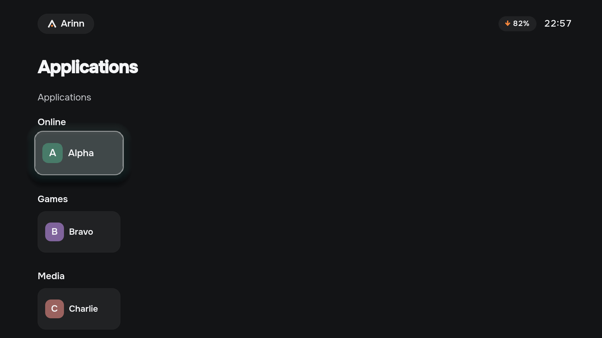
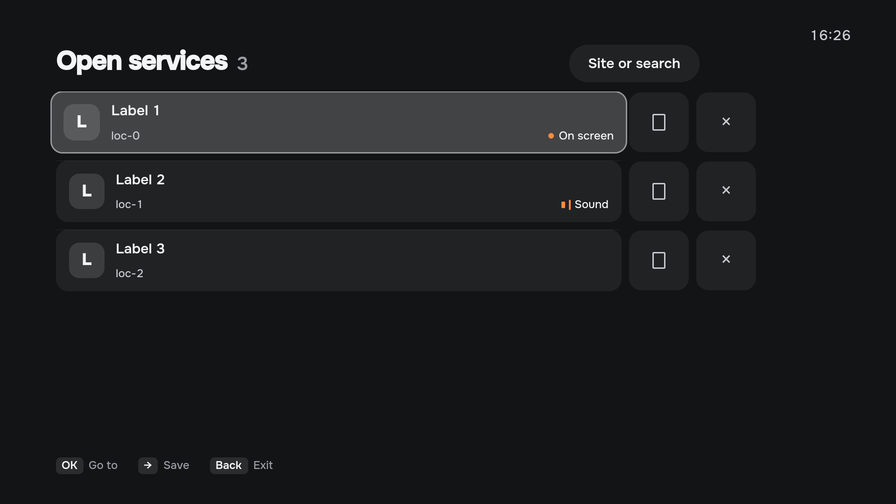
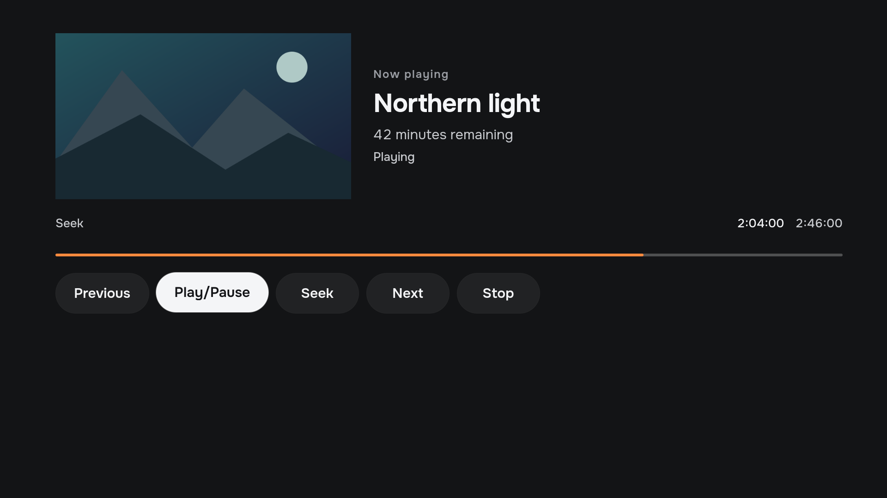

<p align="center">
  
</p>

<h1 align="center">Arinn</h1>

<p align="center">
  A TV-first shell for a Linux home theatre PC.<br>
  Browser, streaming services, local media, Steam and emulators — one calm interface on your TV.
</p>

<p align="center">
  <a href="https://github.com/LimeBeck/arinn/actions/workflows/ci.yml"></a>
  <a href="LICENSE"></a>
  
  
</p>

<p align="center"><a href="README.ru.md">Русская версия</a></p>

---

> [!WARNING]
> **Arinn is pre-alpha.** Phase 1 implements the production core and plugin SDK. The shell binds several screens to the daemon and is still a technical prototype. It is not yet usable as an everyday HTPC shell. See the [roadmap](ROADMAP.md).

## What is Arinn?

Arinn (Old Norse for *hearth*) turns a Linux computer behind the TV into something that feels like a TV: you pick up the remote and ask *"what do we want to do now?"* instead of *"which app do I start?"*.

Arinn does **not** replace your browser, player or game launcher. It orchestrates the applications you already have and stays on top of them. What follows is what the shell on `master` mounts:

- **Home over everything.** Press Home in another application and Arinn appears over it; press Back and you are where you were.
- **Continue and Now playing** read media sessions from `Media1`, with progress and transport controls. The mpv plugin is the playback provider. The local library plugin is the catalogue.
- **Library** reads `Library1`. Posters and fanart load through `Assets1`. A missing image stays a plate.
- **Open services** lists managed browser windows. The packaged web shortcuts include YouTube, Kinopoisk and IVI.
- **Applications** come from the desktop provider, grouped into Online, Games, Media and Other.
- **Settings** reads `Settings1`. Controls are grouped and typed: a toggle, a stepper, text, an option list or a path. A path is plain text. There is no folder browser.
- **Made for a remote:** everything works with arrows, OK and Back from three metres away; an air mouse works too.
- **Shared household:** no accounts, no profiles, no login.

Downloads, the player on-screen display and the power menu are specified and are not mounted. Choosing Downloads shows that the section is not available. Choosing Power reports that power controls are not available. The daemon serves `Browse1`. The shell has no address or search screen. Timeline thumbnails stay with the player binding and are not part of the artwork above.

Every integration is a separate plugin process talking to a small core over D-Bus, so new services can be added without touching Arinn itself.

## Interface preview

These are screenshots of the **current Qt/QML interface**, rendered by the development gallery at 1920×1080 with fictional fixture data, one shared placeholder image and neutral application monograms. Home, navigation, Library, Applications, Open services, Now playing and Settings use the same views the production shell mounts. The gallery does not connect to a daemon. Names, favorites and settings rows in the fixtures are not a catalogue of finished integrations. See the [UI components](docs/architecture/ui-components.md).

**Home** — the Arinn mark, Continue cards and favorite tiles, with remote-control focus on the return card. The other Continue cards show the placeholder landscape and a progress bar.



<details>
<summary>Navigation screenshot</summary>

**Navigation** — the brand lockup and section menu over a dimmed Home, with Home selected.



</details>

<details>
<summary>Library screenshot</summary>

**Library** — Films selected, with the Series tab beside it. Six posters show the placeholder landscape. Late light is the plate drawn when a poster is missing.



</details>

<details>
<summary>Applications screenshot</summary>

**Applications** — tiles grouped into Online, Games and Media, with remote-control focus.



</details>

<details>
<summary>Open services screenshot</summary>

**Open services** — open pages, with the on-screen page marked.



</details>

<details>
<summary>Now playing screenshot</summary>

**Now playing** — the current media session on the placeholder landscape, with progress and transport controls.



</details>

<details>
<summary>Settings screenshot</summary>

**Settings** — Media focused in the category list. The group shows a toggle, an option, a stepper, the path `/media/films` as text, and a path list with `/media/shows` and Add path.


</details>

[Capture instructions and provenance](docs/design/current-ui/README.md). The [22 HTML target-design states](docs/design/handoff/screenshots/) remain available in the [design handoff](docs/design/README.md).

## Status

| Phase | Goal | Status |
| --- | --- | --- |
| 0 | Architecture spike on KDE/Wayland | ✅ Done |
| 1 | Production core, protocol and plugin SDK | In progress |
| 2–4 | Applications, browser, media | Planned |
| 5 | MVP: downloads, full UI, packaging | Planned |

What works today: the Rust daemon, the CLI and the Qt shell; production manifest discovery, paged application state, asynchronous commands and recovery after plugin and daemon crashes. The shell mounts Home, navigation, Applications, Open services, Library (`Library1`), Continue and Now playing (`Media1`), and Settings (`Settings1`). Artwork, posters and fanart load through `Assets1`. Providers on `master` include demo, desktop, Chrome, MPRIS, the local library and mpv. The daemon serves `Browse1`; the shell has no address or search screen. Downloads, the player on-screen display and the power menu are not mounted. Global Home and focus return were verified in Phase 0 (20/20 cycles on two monitors); the migrated runtime also passed 20/20 Home/Back cycles over Chrome and real systemd restart/reload checks ([evidence](docs/architecture/phase-1-live-evidence.json)). There is no stable release yet. Details: [ROADMAP.md](ROADMAP.md) and the [Phase 0 report](docs/architecture/phase-0-report.md).

## Requirements

Target system:

- Arch Linux or EndeavourOS (other distributions should work but are not tested);
- KDE Plasma 6 on **Wayland** (KWin 6);
- a systemd user session;
- a TV with a remote, keyboard or air mouse that sends standard keys.

Building from source:

- Rust (edition 2024) with `cargo`;
- CMake ≥ 3.24, Ninja and a C++20 compiler;
- Qt 6 ≥ 6.6: Quick, Quick Controls, Quick Test, DBus, Test, SVG;
- Python 3, `qdbus6`; Node.js for the adapter tests.

On Arch/EndeavourOS:

```sh
sudo pacman -S --needed rust cmake ninja qt6-base qt6-declarative qt6-svg python nodejs
```

## Try the prototype

There is no stable release yet. Pre-release Arch packages of the prototype are published on the [Releases](https://github.com/LimeBeck/arinn/releases) page. The package starts nothing by itself. To start Arinn after every login for your user on KDE Plasma (Wayland), enable its session target once and log in again:

```sh
systemctl --user enable arinn-session.target    # start daemon, shell and KWin adapter at login
systemctl --user disable arinn-session.target   # stop starting it at login
systemctl --user stop arinn-session.target      # stop it in the current session
```

Disable the target before removing the package. To build and run the current prototype in your own Plasma session from source instead:

```sh
git clone https://github.com/LimeBeck/arinn.git
cd arinn
cargo build --locked
cmake -S . -B build -G Ninja
cmake --build build

python scripts/phase0-session.py start   # start daemon, demo plugin, shell and KWin adapter
python scripts/phase0-session.py stop    # stop everything and unload the adapter
```

The prototype runs as temporary systemd user units and a session-only KWin script; nothing is installed permanently. Full details and test commands: [Phase 0 runbook](docs/architecture/phase-0-runbook.md).

## Controls

| Key | Action |
| --- | --- |
| Meta+F12 | Global Home: show Arinn over the current application (configurable) |
| Arrows | Move focus |
| Enter | Select |
| Esc / Backspace | Back: close Home and return to the application; without one, open navigation |

Remote controls such as the G60S Pro air mouse send these same keys; no driver is needed.

## For contributors

### Architecture at a glance

```text
arinn-shell (Qt 6/QML) ──D-Bus──▶ arinnd (Rust) ──D-Bus──▶ plugins (separate processes)
                                     │                     demo · desktop · chrome
                                     ▼                     mpris · library · mpv
                           KDE platform adapter (KWin)
```

- The **shell** only draws the UI and handles focus locally; it never talks to other applications.
- The **daemon** knows *capabilities* (application, browser, media, library, action, download), never product names.
- **Plugins** implement capabilities in separate processes supervised by systemd, so a crashing integration never takes Arinn down.
- The **platform layer** isolates KDE/Wayland specifics: global shortcut, overlay, window activation.

Read more in the [specification](docs/specifications/arinn-specification.md) and the [architecture decisions](docs/adr/README.md).

### Repository layout

| Path | Content |
| --- | --- |
| `apps/arinn-shell/` | Qt/QML shell |
| `crates/arinnd/` | Daemon |
| `crates/arinn-protocol/` | Shared protocol types (`MIT OR Apache-2.0`) |
| `plugins/` | Arinn's own plugins |
| `platform/kde/` | KWin script adapter |
| `tools/arinnctl/` | Command-line client |
| `tests/` | Integration, UI and operator tests |
| `scripts/` | Development and release scripts |
| `packaging/arch/` | Arch Linux package recipe |
| `docs/` | Specification, ADRs, architecture, plugin API, design |

### Build and test

```sh
cargo fmt --all --check
cargo clippy --locked --all-targets -- -D warnings
cargo test --locked
cargo build --locked --examples
ctest --test-dir build --output-on-failure
cmake --build build && dbus-run-session -- python tests/integration/phase1.py
node --test tests/integration/kwin_adapter.test.cjs
python scripts/check-docs.py
```

Every pull request and a nightly job run the full pipeline, including building the Arch package, installing it into a clean system and smoke-testing it; releases are published only after the whole pipeline passes on the tagged commit ([ADR-0033](docs/adr/0033-ci-cd-and-releases.md)). The full list of required checks, commit conventions, the release process and the Definition of Done are in [CONTRIBUTING.md](CONTRIBUTING.md). AI coding agents also follow [AGENTS.md](AGENTS.md).

### Validate plugin manifests

Plugin discovery also supports an offline check:

```sh
cargo run --locked -p arinnd -- --check-plugins
```

It reads XDG manifest directories and prints JSON diagnostics (exit 0 when valid,
1 for manifest errors, 2 for invalid command usage). It does not start providers
or connect to D-Bus. Runtime discovery and the production wire API are implemented; see the [Phase 1 implementation record](docs/architecture/phase-1-progress.md).

### Writing a plugin

A plugin is any executable that connects to the session bus, registers with `arinnd` and implements one or more capabilities. It is described by a TOML manifest in `~/.local/share/arinn/plugins/`:

```toml
id = "example"
name = "Example Integration"
version = "0.1.0"
api_version = 1
executable = "/usr/lib/arinn/plugins/arinn-plugin-example"
capabilities = ["application"]
```

Plugins supply data and actions, never UI. The Plugin API v1 is **not stable yet**; the protocol crate and the SDK primitives are licensed `MIT OR Apache-2.0`, so your plugin may use any license. See the [Plugin API](docs/plugin-api/README.md) and [plugin runtime](docs/architecture/plugin-runtime.md).

### Documentation map

| Document | Purpose |
| --- | --- |
| [Specification](docs/specifications/arinn-specification.md) | Current requirements — the source of truth |
| [Roadmap](ROADMAP.md) | Phases, exit criteria, status |
| [ADRs](docs/adr/README.md) | Why decisions were made |
| [Architecture](docs/README.md) | Technical contracts, Phase 0 evidence |
| [Design](docs/design/README.md) | Design handoff, design system, brand |
| [Changelog](CHANGELOG.md) | Notable changes |

## Contributing

Contributions are welcome. Please read [CONTRIBUTING.md](CONTRIBUTING.md), follow the [Code of Conduct](CODE_OF_CONDUCT.md) and sign the [Contributor License Agreement](CLA.md) on your first pull request. Report security issues privately as described in [SECURITY.md](SECURITY.md).

## License

- Arinn is licensed under the [GNU General Public License v3.0 or later](LICENSE).
- `crates/arinn-protocol`, the plugin SDK and the D-Bus interface definitions are licensed under [MIT](LICENSES/MIT.txt) or [Apache-2.0](LICENSES/Apache-2.0.txt), at your option.
- Documentation and design materials are licensed under [CC-BY-SA-4.0](LICENSES/CC-BY-SA-4.0.txt).
- Qt is used under the LGPL-3.0. The repository contains no third-party logos; service names such as Kinopoisk, IVI, YouTube or Steam are used only to describe integrations and belong to their owners.

Each file states its license with an SPDX header or in [REUSE.toml](REUSE.toml). See [ADR-0029](docs/adr/0029-licensing.md) for the reasoning.

The isolated [UI component gallery](docs/architecture/ui-components.md) runs with
`build/apps/arinn-shell/arinn-ui-gallery`, without a daemon or desktop integration.
