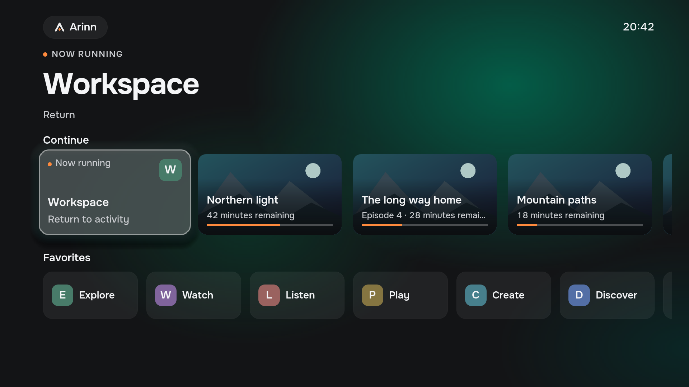
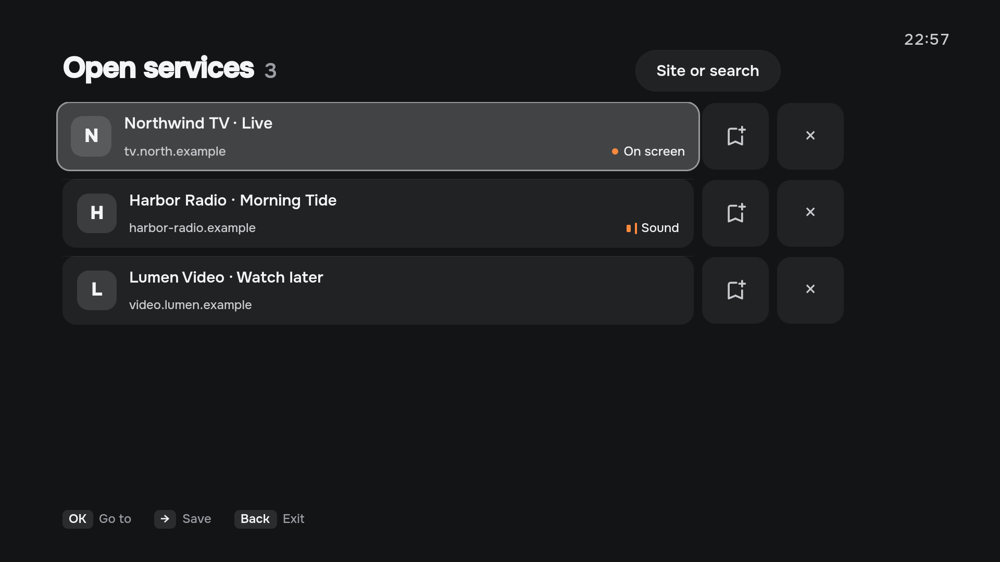
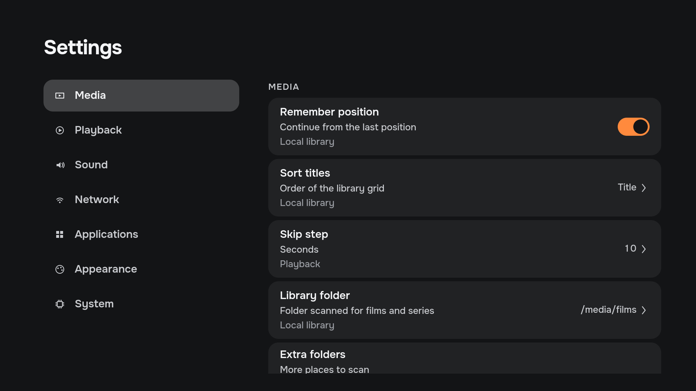
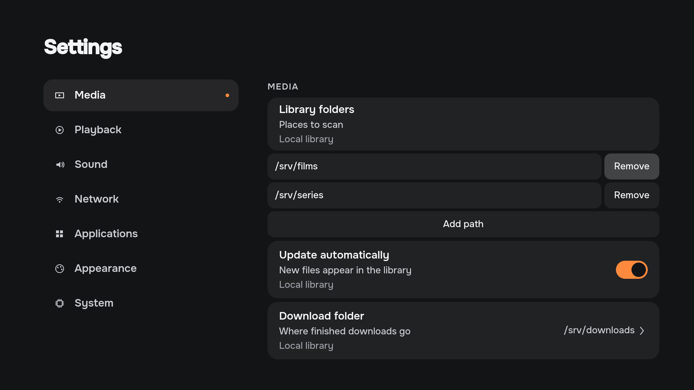

<p align="center">
  
</p>

<h1 align="center">Arinn</h1>

<p align="center">
  A TV-first shell for a Linux home theatre PC.<br>
  Browser, streaming services, local media, Steam and emulators — one calm interface on your TV.
</p>

<p align="center">
  <a href="https://github.com/LimeBeck/arinn/actions/workflows/ci.yml"></a>
  <a href="LICENSE"></a>
  
  
</p>

<p align="center"><a href="README.ru.md">Русская версия</a></p>

---

> [!WARNING]
> **Arinn is pre-alpha.** Current source builds connect apps, websites, local media, playback, downloads and settings. Hardware and service compatibility still need qualification; there is no stable release yet. Published packages can lag behind `master`. See the [roadmap](ROADMAP.md).

An optional KDE Plasma 6/X11 session mode is under preparation alongside the
Wayland MVP. See [KDE/X11 setup and qualification limits](docs/architecture/kde-x11.md).
The optional [generic EWMH backend](docs/architecture/x11-ewmh.md) adds a separate
X11 adapter for other window managers; real desktop qualification is pending.

## What is Arinn?

Arinn (Old Norse for *hearth*) brings the Linux apps you already use into one TV-friendly starting point. Open Home over an application, then return with Back without closing it.

Current source builds include:

- **Home and Continue.** Return to running applications and resumable media, with an activity backdrop and visible remote-control focus.
- **Websites and open services.** Use Site or search, save a website as a shortcut, and switch between managed Chrome/Chromium windows. The packaged extension connects the browser to Arinn.
- **Applications and games.** Launch installed desktop applications, Steam or ES-DE. Choose games inside their own launcher; Arinn does not provide a Steam or emulator game catalogue.
- **Local library and playback.** Scan local or already mounted folders, browse films and series, and play with mpv. The playback overlay offers seeking, audio/subtitle selection and transport controls when the provider supports them.
- **Downloads.** View a connected Transmission queue, control jobs and open imported media in the library. Transmission must be installed and configured separately.
- **Settings.** Edit provider settings and library folder lists. Text and paths can be entered with the on-screen keyboard; a graphical folder picker is still pending.
- **Controls over an app.** Global Home, the quick menu and the on-screen keyboard are available through configurable shortcuts. Power actions depend on the desktop/session and the capabilities it reports.

Arinn uses one shared household space, with no Arinn accounts or profiles. Keyboard-compatible remotes, a keyboard and an air mouse can navigate the shell; controls inside external applications remain those applications' responsibility.

Integrations run as separate plugin processes. Details and setup are in the [user guide](https://limebeck.github.io/arinn/guide/).

## Interface preview

These four captures come from the current Qt/QML views through `tests/ui/visual` at 1920×1080. They use fictional services on `.example` domains, neutral monograms, original placeholder artwork and a fixed clock. They do not connect to a daemon or control a desktop, and they are not evidence of completed hardware qualification.

**Home** — Continue cards, fictional favorite tiles and remote-control focus.



<details>
<summary>Open services</summary>

Managed browser activities, with the active service and sound state marked. Bookmark actions are drawn icons, independent of installed icon fonts.



</details>

<details>
<summary>Settings</summary>

Appearance settings for the light field, ambient timeout and text size, with their source lines.



</details>

<details>
<summary>Library folders</summary>

The current inline folder list in Settings, with two fictional paths and actions to add or remove them. This is not a graphical folder picker.



</details>

[Capture instructions and provenance](docs/design/showcase/README.md). The [design handoff](docs/design/README.md) remains the visual reference; these captures do not close its outstanding design issues.

## Status

The repository is public and the project is pre-alpha. The daemon, CLI, plugin SDK and connected Qt shell are implemented; the source includes browser integration, local media/mpv playback, Transmission downloads, settings and dedicated session support. Implementation does not mean that every service, TV, codec or desktop has been qualified.

The [roadmap](ROADMAP.md) is the source of phase and acceptance status. Its completed core/application phases and remaining browser, media and MVP gates are distinct from the features already connected in source. The [Releases](https://github.com/LimeBeck/arinn/releases) page contains pre-release packages and source snapshots, not a stable release. Check each release's commit before comparing an older package with this README.

## Requirements

Target system:

- Arch Linux or EndeavourOS (other distributions should work but are not tested);
- KDE Plasma 6 on **Wayland** (KWin 6) for the primary setup; see the linked X11/XFCE guides for their setup and qualification limits;
- a systemd user session;
- a TV with a remote, keyboard or air mouse that sends standard keys.

Building from source:

- Rust (edition 2024) with `cargo`;
- CMake ≥ 3.24, Ninja and a C++20 compiler;
- Qt 6 ≥ 6.8, the minimum supported Qt ([ADR-0104](docs/adr/0104-qt-floor-and-prebuilt-ci-images.md)): Quick, Quick Controls, Quick Test, DBus, Test, SVG;
- Python 3, `qdbus6`; Node.js for the adapter tests;
- libcurl, libunwind and OpenSSL development files. CMake downloads checksum-pinned
  Sentry native and toml++ sources; telemetry stays disabled at runtime by default.

On Arch/EndeavourOS:

```sh
sudo pacman -S --needed rust cmake ninja qt6-base qt6-declarative qt6-svg qt6-tools python nodejs curl libunwind openssl
```

Sentry diagnostics are optional in the shell and daemon. The separate
`$XDG_CONFIG_HOME/arinn/telemetry.toml` file defaults to disabled; see
[configuration, captured data and limitations](docs/architecture/telemetry.md).

## Try the prototype

Download the main x86_64 Arch package and `SHA256SUMS` from the same [release](https://github.com/LimeBeck/arinn/releases). Compare the downloaded package's SHA-256 with its entry before installing it. Use the actual package filename in place of the placeholders:

```sh
sha256sum ./arinn-*.pkg.tar.zst
sudo pacman -U ./arinn-<version>-<release>-x86_64.pkg.tar.zst
```

There is no stable release yet, and current source features may be newer than a published package. Installation starts no session and enables no autostart. To start Arinn after every login on KDE Plasma (Wayland), enable its user target once and log in again:

```sh
systemctl --user enable arinn-session.target    # start daemon, shell and KWin adapter at login
systemctl --user disable arinn-session.target   # stop starting it at login
systemctl --user stop arinn-session.target      # stop it in the current session
```

To start it once, or to bring up Home when it already runs, open **Arinn** from the application menu; this does not enable autostart. Disable the target before removing the package. Instead of autostart, you can choose the **Arinn** (Plasma, Wayland) or **Arinn (XFCE)** session at login, or make it the display manager's autologin session; the **Return to Arinn** menu entry, and **Switch to desktop** once the power menu offers it, move between it and the plain desktop ([session lifecycle](docs/architecture/session-lifecycle.md#dedicated-arinn-session)). For an isolated demo-only developer smoke session, build from source below. This launcher starts the demo provider, not the full set of packaged integrations, and changes the live KDE session; use a disposable Plasma session. For a full installation, use the package above or the [source-package workflow](CONTRIBUTING.md#required-checks).

```sh
git clone https://github.com/LimeBeck/arinn.git
cd arinn
cargo build --locked
cmake -S . -B build -G Ninja
cmake --build build

python scripts/phase0-session.py start   # start daemon, demo plugin, shell and KWin adapter
python scripts/phase0-session.py stop    # stop everything and unload the adapter
```

The demo session runs as temporary systemd user units and a session-only KWin script; nothing is installed permanently. Full details and test commands: [Phase 0 runbook](docs/architecture/phase-0-runbook.md).

## Controls

| Key | Action |
| --- | --- |
| Meta+F12, remote Home | Global Home: show Arinn over the current application (`home_shortcut` in `config.toml`) |
| Meta+F11, remote Menu (≡) | Quick menu: a side sheet over the current application (`quick_menu_shortcut` in `config.toml`). Inside Arinn, Menu toggles navigation |
| Meta+F10, remote microphone | On-screen keyboard over the current application; again to hide it (`keyboard_shortcut` in `config.toml`) |
| Remote power (⏻) | Arinn's power menu instead of the desktop's power dialog, while Arinn runs. Nothing happens on the lock screen. Older KDE Plasma (before 6.7) and the ordinary XFCE desktop keep their own dialog; on XFCE, Arinn takes the key only in the dedicated "Arinn (XFCE)" session |
| Arrows | Move focus |
| Enter | Select |
| Esc / Backspace | Back: close Home and return to the application; without one, open navigation |

Remote controls such as the G60S Pro air mouse send these same keys; no driver is needed.

## For contributors

### Architecture at a glance

```text
arinn-shell (Qt 6/QML) ──D-Bus──▶ arinnd (Rust) ──D-Bus──▶ plugins (separate processes)
                                     │                     demo · desktop · chrome
                                     ▼                     mpris · library · mpv · transmission
                           Platform adapters (KWin / X11 EWMH)
```

- The **shell** only draws the UI and handles focus locally; it never talks to other applications.
- The **daemon** knows *capabilities* (application, browser, media, library, action, download), never product names.
- **Plugins** implement capabilities in separate processes supervised by systemd, so a crashing integration never takes Arinn down.
- The **platform layer** isolates KDE/KWin and X11/EWMH specifics: global shortcuts, overlays and window activation.

Read more in the [specification](docs/specifications/arinn-specification.md) and the [architecture decisions](docs/adr/README.md).

### Repository layout

| Path | Content |
| --- | --- |
| `apps/arinn-shell/` | Qt/QML shell |
| `crates/arinnd/` | Daemon |
| `crates/arinn-protocol/` | Shared protocol types (`MIT OR Apache-2.0`) |
| `plugins/` | Arinn's own plugins |
| `platform/kde/` | KWin script adapter |
| `tools/arinnctl/` | Command-line client |
| `tests/` | Integration, UI and operator tests |
| `scripts/` | Development and release scripts |
| `packaging/arch/` | Arch Linux package recipe (release blocker) |
| `packaging/debian/` | Debian `.deb` recipe (CI artifact; see [packaging/debian/README.md](packaging/debian/README.md)) |
| `docs/` | Specification, ADRs, architecture, plugin API, design |

### Build and test

```sh
cargo fmt --all --check
cargo clippy --locked --all-targets -- -D warnings
cargo test --locked
cargo build --locked --examples
ctest --test-dir build --output-on-failure
cmake --build build && dbus-run-session -- python tests/integration/phase1.py
node --test tests/integration/kwin_adapter.test.cjs
python scripts/check-docs.py
```

Pull requests run the Rust, Qt and integration checks; Markdown/changelog-only changes run the documentation and licensing scope. Package builds and clean install smoke tests run on `master`, nightlies, manual CI and releases ([ADR-0102](docs/adr/0102-packages-built-for-master-only.md)). A release is published only after its gated pipeline passes ([ADR-0033](docs/adr/0033-ci-cd-and-releases.md)). The full list of required checks, commit conventions, the release process and the Definition of Done are in [CONTRIBUTING.md](CONTRIBUTING.md). AI coding agents also follow [AGENTS.md](AGENTS.md).

### Validate plugin manifests

Plugin discovery also supports an offline check:

```sh
cargo run --locked -p arinnd -- --check-plugins
```

It reads XDG manifest directories and prints JSON diagnostics (exit 0 when valid,
1 for manifest errors, 2 for invalid command usage). It does not start providers
or connect to D-Bus. Runtime discovery and the production wire API are implemented; see the [Phase 1 implementation record](docs/architecture/phase-1-progress.md).

### Writing a plugin

A plugin is any executable that connects to the session bus, registers with `arinnd` and implements one or more capabilities. It is described by a TOML manifest in `~/.local/share/arinn/plugins/`:

```toml
id = "example"
name = "Example Integration"
version = "0.1.0"
api_version = 1
executable = "/usr/lib/arinn/plugins/arinn-plugin-example"
capabilities = ["application"]
```

Plugins supply data and actions, never UI. The Plugin API v1 is **not stable yet**; the protocol crate and the SDK primitives are licensed `MIT OR Apache-2.0`, so your plugin may use any license. See the [Plugin API](docs/plugin-api/README.md) and [plugin runtime](docs/architecture/plugin-runtime.md).

### Documentation map

The [user guide website](docs/user/index.html) covers installation, controls,
browser setup, media and troubleshooting. [Preview and Pages setup](docs/user/README.md).

| Document | Purpose |
| --- | --- |
| [Specification](docs/specifications/arinn-specification.md) | Current requirements — the source of truth |
| [Roadmap](ROADMAP.md) | Phases, exit criteria, status |
| [ADRs](docs/adr/README.md) | Why decisions were made |
| [Architecture](docs/README.md) | Technical contracts, Phase 0 evidence |
| [Design](docs/design/README.md) | Design handoff, design system, brand |
| [Changelog](CHANGELOG.md) | Notable changes |

## Contributing

Contributions are welcome. Please read [CONTRIBUTING.md](CONTRIBUTING.md), follow the [Code of Conduct](CODE_OF_CONDUCT.md) and sign the [Contributor License Agreement](CLA.md) on your first pull request. Report security issues privately as described in [SECURITY.md](SECURITY.md).

## License

- Arinn is licensed under the [GNU General Public License v3.0 or later](LICENSE).
- `crates/arinn-protocol`, the plugin SDK and the D-Bus interface definitions are licensed under [MIT](LICENSES/MIT.txt) or [Apache-2.0](LICENSES/Apache-2.0.txt), at your option.
- Documentation and design materials are licensed under [CC-BY-SA-4.0](LICENSES/CC-BY-SA-4.0.txt).
- Qt is used under the LGPL-3.0. The repository contains no third-party logos; service names such as Kinopoisk, IVI, YouTube or Steam are used only to describe integrations and belong to their owners.

Each file states its license with an SPDX header or in [REUSE.toml](REUSE.toml). See [ADR-0029](docs/adr/0029-licensing.md) for the reasoning.

The isolated [UI component gallery](docs/architecture/ui-components.md) runs with
`build/apps/arinn-shell/arinn-ui-gallery`, without a daemon or desktop integration.
It shows components only; screens and their states are rendered from
[`tests/ui/visual`](tests/ui/visual/) with `python scripts/ui-compare.py`.
