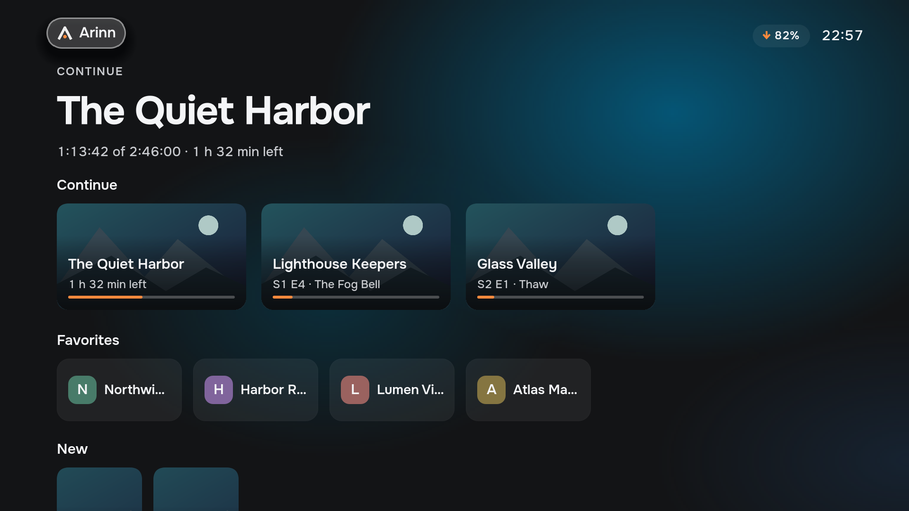
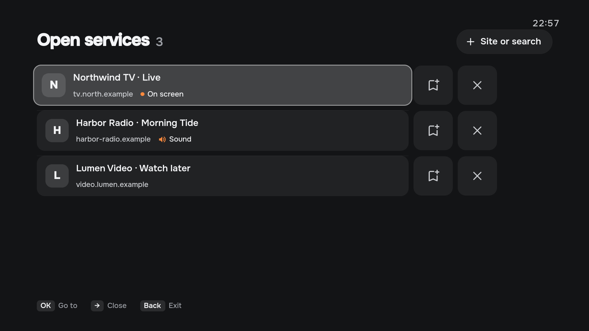
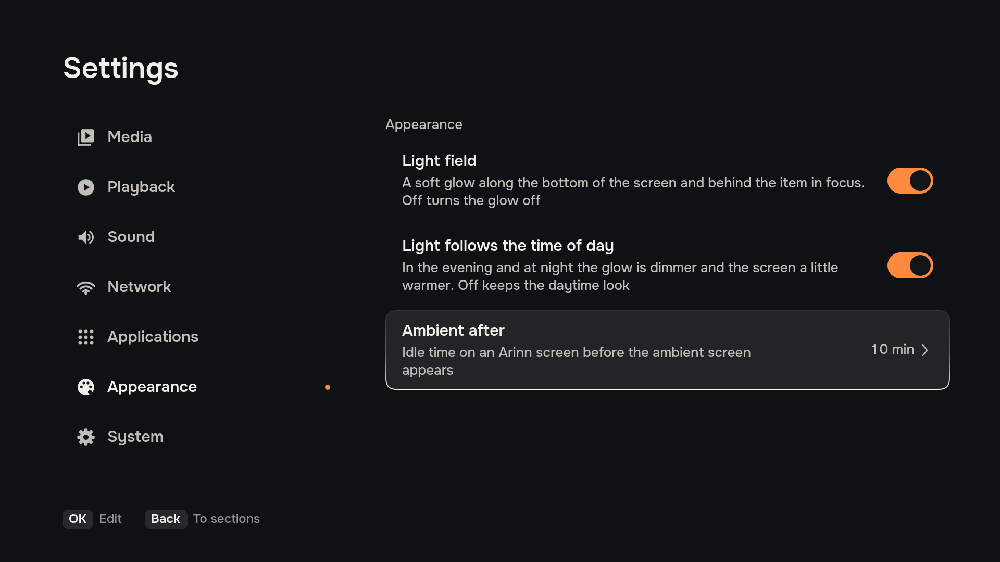
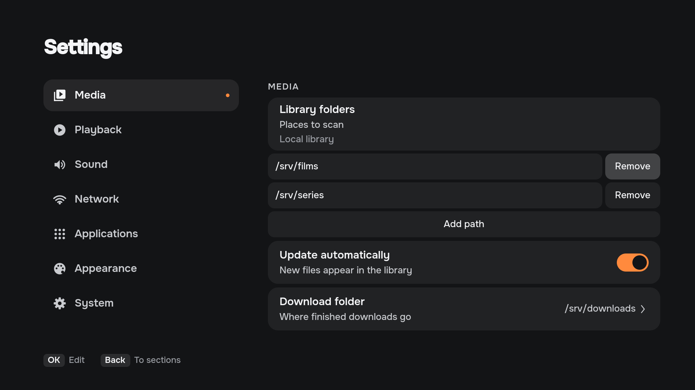
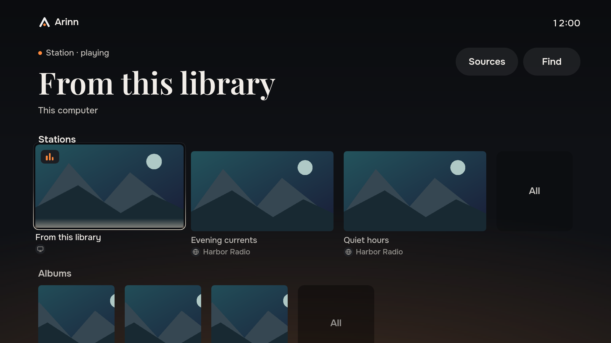
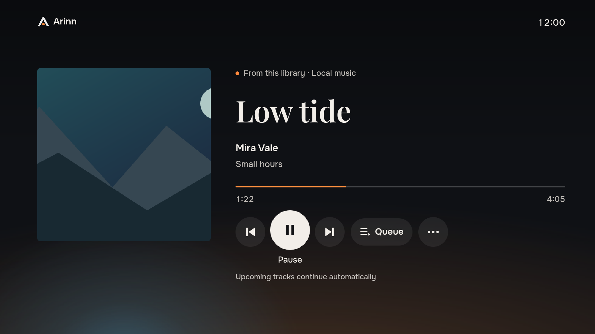

<p align="center">
  
</p>

<h1 align="center">Arinn</h1>

<p align="center">
  TV-оболочка для Linux HTPC.<br>
  Браузер, онлайн-кинотеатры, локальное медиа, Steam и эмуляторы — в одном спокойном интерфейсе на телевизоре.
</p>

<p align="center"><a href="README.md">English version</a> — основная документация проекта на английском</p>

---

> [!WARNING]
> **Arinn на ранней стадии (pre-alpha).** В текущих исходниках подключены приложения, сайты, медиатека, музыка, воспроизведение, загрузки и настройки. Совместимость с оборудованием и сервисами ещё требует проверки. Опубликованные пакеты могут отставать от `master`. Статусы — в [роадмапе](ROADMAP.md).

## Что такое Arinn

Arinn (древнескандинавское «очаг») объединяет привычные Linux-приложения в одном интерфейсе для телевизора. Откройте Home поверх приложения, затем вернитесь к нему кнопкой «Назад», не закрывая его.

В текущих исходниках доступны:

- **Home и «Продолжить».** Возврат к работающим приложениям и медиа с сохранённым прогрессом; фон текущего приложения и видимый фокус управления пультом. Действия плитки позволяют закреплять и откреплять избранное; плитки следуют порядку закрепления.
- **Сайты и открытые сервисы.** Экран «Сайт или поиск», сохранение веб-ярлыков и переключение между управляемыми окнами Chrome/Chromium. Браузер подключается через расширение из пакета.
- **Приложения и игры.** Запуск установленных приложений, Steam и ES-DE. Игры выбираются внутри их лаунчера; собственного каталога игр Steam или эмуляторов в Arinn нет.
- **Медиатека и воспроизведение.** Сканирование локальных и уже смонтированных папок, фильмы и сериалы, воспроизведение через mpv. Панель плеера предлагает перемотку, выбор звука/субтитров и управление воспроизведением, когда провайдер поддерживает эти действия.
- **Музыка.** Общая музыкальная комната, полки источников, поиск и экран Now playing. Реализованы провайдеры локальной музыки и Яндекс Музыки; совместимость аккаунтов, потоков и аудиоустройств ещё проверяется. Остальные запланированные сервисы не реализованы. См. [настройку и ограничения](docs/architecture/music-backends.md).
- **Загрузки.** Подключённая очередь Transmission, управление заданиями и переход к импортированному медиа в библиотеке. Сам Transmission нужно установить и настроить отдельно.
- **Настройки.** Параметры провайдеров и списки папок медиатеки. Графический выбор папки показывает места и вложенные каталоги. Для текста и поддерживаемых одиночных путей в настройках есть экранная клавиатура. В оформлении доступны световой фон Hearth, освещение по времени суток и время до заставки.
- **Управление поверх приложения.** Глобальный Home, быстрое меню и экранная клавиатура вызываются настраиваемыми сочетаниями. Действия питания зависят от рабочего окружения, сессии и доступных возможностей.

У Arinn общее домашнее пространство без собственных аккаунтов и профилей. Оболочкой управляют пульт со стандартными клавишами, клавиатура или аэромышь; управление внутри внешнего приложения зависит от самого приложения.

Интеграции работают отдельными процессами плагинов. Настройка описана в [руководстве пользователя](https://limebeck.github.io/arinn/guide/) на английском.

## Превью интерфейса

Шесть кадров обновлены 7 ноября 2026 года с текущих Qt/QML-экранов через `tests/ui/visual` при 1920×1080. Сервисы и домены `.example` вымышлены, иконки нейтральны, иллюстрации — собственные заглушки, часы фиксированы. Съёмка не подключается к демону и не управляет рабочим столом; она не подтверждает прохождение тестов на реальном телевизоре.

**Home** — карточки «Продолжить», вымышленные плитки избранного и фокус пульта.



<details>
<summary>Открытые сервисы</summary>

Окна браузера: пометки «на экране» и «звук» рядом с адресом, кнопки закладки и закрытия, кнопка «Сайт или поиск». Значки рисуются независимо от установленных шрифтов иконок.



</details>

<details>
<summary>Настройки</summary>

Параметры оформления: световой фон, освещение по времени суток и время до заставки.



</details>

<details>
<summary>Папки медиатеки</summary>

Графический выбор папки: вымышленные места и вложенные каталоги, текущий путь и кнопка выбора текущей папки.



</details>

<details>
<summary>Музыка</summary>

Общая музыкальная комната с вымышленными станциями и альбомами из двух источников.



</details>

<details>
<summary>Сейчас играет</summary>

Вымышленные обложка и сведения о треке, доступные у источника кнопки воспроизведения.



</details>

[Съёмка и происхождение кадров](docs/design/showcase/README.md). [Материалы дизайна](docs/design/README.md) остаются визуальным ориентиром; эти кадры не закрывают оставшиеся замечания по дизайну.

## Статус

Репозиторий открыт, проект остаётся pre-alpha. Реализованы демон, CLI, SDK плагинов и подключённая Qt-оболочка; в исходниках есть браузерная интеграция, медиатека/mpv, музыка, Transmission, настройки и отдельные сессии входа. Наличие реализации не означает, что проверены все сервисы, телевизоры, кодеки и рабочие окружения.

[Роадмап](ROADMAP.md) определяет статусы фаз и критериев приёмки. Завершённые этапы ядра/приложений и оставшиеся проверки браузера, медиа и MVP — не перечень уже подключённых экранов. В [Releases](https://github.com/LimeBeck/arinn/releases) есть выпуск с тегом `v0.2.0` и автоматические предрелизы `snapshot-…`. Наличие тега не меняет статус pre-alpha. Сверяйте коммит и файлы релиза: старый пакет может отличаться от этого README, а в снимках пока нет Debian-пакета ([#692](https://github.com/LimeBeck/arinn/issues/692)).

По сообщению владельца от 7 ноября 2026 года подтверждены текущий интерфейс на TV, музыка, видео, загрузки и быстрое меню ([запись](https://github.com/LimeBeck/arinn/issues/866#issuecomment-6704400452)). Звуки интерфейса не слышны; проверки питания и переключения сессий, других платформ и численные замеры остаются открытыми.

## Требования

- Arch Linux или EndeavourOS;
- KDE Plasma 6 на **Wayland** или XFCE на **X11** — целевые платформы MVP; текущий TV-интерфейс принят владельцем, дополнительные платформы и конфигурации ещё проверяются; см. [настройку XFCE/X11](docs/architecture/x11-ewmh.md). Дополнительный вариант KDE/X11 описан [отдельно](docs/architecture/kde-x11.md);
- шина графической сессии; описанный автозапуск использует пользовательские службы systemd. Лаунчеры отдельной сессии поддерживают прямой запуск без пользовательского менеджера служб ([жизненный цикл](docs/architecture/session-lifecycle.md));
- пульт, клавиатура или аэромышь со стандартными клавишами.

Для сборки: Rust (edition 2024), CMake ≥ 3.24, Ninja, компилятор C++20, Qt 6 ≥ 6.8 (Quick, Quick Controls, Quick Test, DBus, Test, SVG, Multimedia и Linguist tools), Python 3, `qdbus6`, libcurl, libunwind и OpenSSL; Node.js нужен для тестов адаптеров. Sentry native и toml++ загружаются с проверкой контрольных сумм. Диагностика по умолчанию выключена; [настройка и ограничения](docs/architecture/telemetry.md).

```sh
sudo pacman -S --needed rust cmake ninja qt6-base qt6-declarative qt6-svg qt6-multimedia qt6-tools python nodejs curl libunwind openssl
```

Для воспроизведения медиа и музыки установите `mpv`, для анализа локальных файлов — `ffmpeg`. Transmission и внешние приложения устанавливаются отдельно.

## Попробовать прототип

Скачайте основной x86_64-пакет Arch и `SHA256SUMS` из одного [релиза](https://github.com/LimeBeck/arinn/releases). Перед установкой сравните SHA-256 пакета со строкой в файле сумм. Вместо шаблона укажите настоящее имя файла:

```sh
sha256sum ./arinn-*.pkg.tar.zst
sudo pacman -U ./arinn-<version>-<release>-x86_64.pkg.tar.zst
```

Текущие исходники могут быть новее опубликованного пакета. Установка не запускает сессию и не включает автозапуск. Чтобы Arinn стартовал при входе в KDE Plasma (Wayland), один раз включите пользовательскую цель сессии и войдите снова:

```sh
systemctl --user enable arinn-session.target    # демон, оболочка и адаптер KWin при входе
systemctl --user disable arinn-session.target   # больше не запускать при входе
systemctl --user stop arinn-session.target      # остановить в текущей сессии
```

Откройте **Arinn** из меню приложений для разового запуска или возврата к Home — автозапуск при этом не включается. Перед удалением пакета цель нужно выключить. На экране входа можно выбрать отдельную сессию **Arinn** (Plasma, Wayland) или **Arinn (XFCE)**. Команды **Switch to desktop** в меню питания и **Return to Arinn** в меню рабочего стола переключают её с обычным рабочим столом ([подробнее](docs/architecture/session-lifecycle.md#dedicated-arinn-session)).

Ниже — сборка из исходников и изолированный демонстрационный запуск для разработчика. Он подключает только демо-провайдер, а не все интеграции из пакета, и меняет живую сессию KDE; используйте отдельную тестовую сессию Plasma. Для полной установки используйте пакет выше или [сборку пакета из исходников](CONTRIBUTING.md#required-checks).

```sh
git clone https://github.com/LimeBeck/arinn.git
cd arinn
cargo build --locked
cmake -S . -B build -G Ninja
cmake --build build

python scripts/phase0-session.py start   # запустить демон, демо-плагин, оболочку и адаптер KWin
python scripts/phase0-session.py stop    # всё остановить и выгрузить адаптер
```

Демонстрационная сессия работает во временных пользовательских юнитах systemd и в скрипте KWin, загруженном только на текущую сессию; ничего не устанавливается постоянно. Подробнее: [Phase 0 runbook](docs/architecture/phase-0-runbook.md) (на английском).

## Управление

| Клавиша | Действие |
| --- | --- |
| Meta+F12, Home на пульте | Глобальный Home: Arinn поверх текущего приложения (`home_shortcut` в `config.toml`) |
| Meta+F11, Menu (≡) на пульте | Быстрое меню: боковая панель поверх текущего приложения (`quick_menu_shortcut` в `config.toml`). Внутри Arinn Menu открывает навигацию |
| Meta+F10, микрофон на пульте | Экранная клавиатура поверх текущего приложения; повторное нажатие скрывает её (`keyboard_shortcut` в `config.toml`) |
| Питание (⏻) на пульте | Меню питания Arinn вместо диалога питания рабочего стола, пока Arinn запущен. На экране блокировки ничего не происходит. Более старая KDE Plasma (до 6.7) и обычный рабочий стол XFCE сохраняют свой диалог; в XFCE Arinn забирает кнопку только в отдельном сеансе «Arinn (XFCE)» |
| Стрелки | Перемещение фокуса |
| Enter | Выбор |
| Esc / Backspace | Назад: закрыть Home и вернуться в приложение; если приложения нет — открыть навигацию |

Пульты вроде аэромыши G60S Pro отправляют те же клавиши, драйвер не нужен.

## Участие в разработке

Документация для разработчиков, правила участия и соглашение контрибьютора — на английском: [README](README.md#for-contributors), [CONTRIBUTING.md](CONTRIBUTING.md), [CLA.md](CLA.md). Issue можно писать на русском.

## Лицензия

Arinn распространяется по [GPL-3.0-or-later](LICENSE). Крейт протокола и SDK для плагинов — `MIT OR Apache-2.0`, поэтому плагины можно писать под любой лицензией. Документация — CC-BY-SA-4.0. Подробности — в [README](README.md#license).
