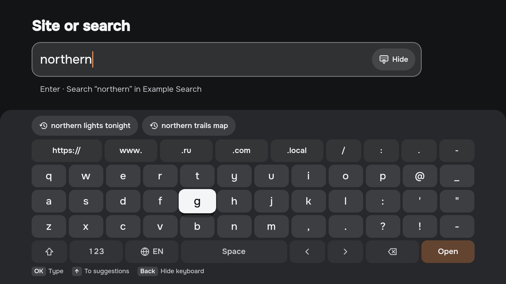

<p align="center">
  
</p>

<h1 align="center">Arinn</h1>

<p align="center">
  TV-оболочка для Linux HTPC.<br>
  Браузер, онлайн-кинотеатры, локальное медиа, Steam и эмуляторы — в одном спокойном интерфейсе на телевизоре.
</p>

<p align="center"><a href="README.md">English version</a> — основная документация проекта на английском</p>

---

> [!WARNING]
> **Arinn на ранней стадии (pre-alpha).** Phase 1 — это рабочее ядро и SDK плагинов. Оболочка уже привязывает несколько экранов к демону, но это всё ещё технический прототип. Для повседневного использования Arinn пока не готов. Планы — в [роадмапе](ROADMAP.md).

## Что такое Arinn

Arinn (древнескандинавское «очаг») превращает компьютер за телевизором в понятный TV-интерфейс: берёте пульт и выбираете, *чем заняться*, а не *какое приложение запустить*.

Arinn не заменяет браузер, плеер или игровой лаунчер. Он управляет уже установленными приложениями и работает поверх них. Ниже — то, что оболочка на `master` реально показывает:

- **Home поверх всего.** Нажмите Home в другом приложении — Arinn появится поверх; нажмите «Назад» — вернётесь туда же.
- **«Продолжить» и «Сейчас играет»** читают медиасессии `Media1`: прогресс и кнопки воспроизведения. Воспроизведение даёт плагин mpv, каталог — локальная медиатека.
- **Медиатека** читает `Library1`. Постеры и фанарт загружаются через `Assets1`; если изображения нет, остаётся пластина.
- **Открытые сервисы** — список окон браузера. В поставке есть веб-ярлыки YouTube, Кинопоиск и IVI.
- **Приложения** приходят от desktop-провайдера и сгруппированы в Online, Games, Media и Other.
- **Настройки** читают `Settings1`. Элементы сгруппированы по типам: переключатель, счётчик, текст, список вариантов или путь. Путь — обычный текст, без выбора папки.
- **Под пульт:** всё управляется стрелками, OK и «Назад» с трёх метров; аэромышь тоже работает.
- **Общий дом:** без аккаунтов, профилей и входа.

Загрузки, экранное меню плеера и меню питания описаны в спецификации и в оболочку не встроены. Выбор «Загрузки» показывает, что раздела ещё нет. Выбор «Питание» сообщает, что этих действий нет. Демон отдаёт `Browse1`. Экрана адреса и поиска в оболочке нет. Миниатюры шкалы времени остаются у привязки плеера и к этим изображениям не относятся.

## Интерфейс

Это скриншоты **текущего интерфейса Qt/QML**, снятые в галерее разработки при 1920×1080 с вымышленными данными, одной общей иллюстрацией-заглушкой и нейтральными монограммами приложений. Home, навигация, медиатека, приложения, открытые сервисы, экранная клавиатура, текущее воспроизведение и настройки используют те же экраны, что и рабочая оболочка. Галерея не подключается к демону. Имена, избранное и строки настроек на карточках не означают готовые интеграции. Подробнее о компонентах: [статус реализации UI](docs/architecture/ui-components.md).

**Home** — знак Arinn, блок Now running, карточки Continue и плитки избранного на фоне светового поля; фокус пульта на карточке возврата. На остальных карточках Continue — иллюстрация-заглушка и полоса прогресса.


<details>
<summary>Скриншот навигации</summary>

**Навигация** — фирменный знак и меню разделов (Home, Library, Downloads, Applications, Settings, Open services) поверх затемнённого Home, выбран пункт Home.


</details>

<details>
<summary>Скриншот библиотеки</summary>

**Библиотека** — выбрана вкладка Films, рядом вкладка Series. Шесть постеров показывают иллюстрацию-заглушку. Late light — пластина, которую оболочка рисует, когда постера нет.


</details>

<details>
<summary>Скриншот приложений</summary>

**Приложения** — плитки по группам Online, Games и Media, с заметным фокусом для пульта.


</details>

<details>
<summary>Скриншот открытых сервисов</summary>

**Открытые сервисы** — открытые страницы, с отметкой страницы на экране.


</details>

<details>
<summary>Скриншот экранной клавиатуры</summary>

**Экранная клавиатура** — «Сайт или поиск», набранный одним пультом: подсказки из недавних запросов и открытого сервиса, адресный ряд, английские буквы с фокусом пульта и ряд действий с кнопкой Open.



</details>

<details>
<summary>Скриншот текущего воспроизведения</summary>

**Сейчас играет** — текущая медиасессия на иллюстрации-заглушке, с прогрессом и кнопками управления.


</details>

<details>
<summary>Скриншот настроек</summary>

**Настройки** — выбран Media. В группе переключатель, вариант Title, счётчик 10 и путь `/media/films` как текст.


</details>

[Как воспроизвести скриншоты](docs/design/current-ui/README.md). Все [22 состояния целевого HTML-дизайна](docs/design/handoff/screenshots/) сохранены в [материалах дизайна](docs/design/README.md).

## Требования

- Arch Linux или EndeavourOS;
- KDE Plasma 6 на **Wayland**;
- пользовательская сессия systemd;
- пульт, клавиатура или аэромышь со стандартными клавишами.

Для сборки: Rust (edition 2024), CMake ≥ 3.24, Ninja, компилятор C++20, Qt 6 ≥ 6.8 (Quick, Quick Controls, Quick Test, DBus, Test, SVG), Python 3, `qdbus6`.

```sh
sudo pacman -S --needed rust cmake ninja qt6-base qt6-declarative qt6-svg python nodejs
```

## Попробовать прототип

Стабильного выпуска нет. Предрелизные пакеты прототипа для Arch лежат на странице [Releases](https://github.com/LimeBeck/arinn/releases). Пакет сам ничего не запускает. Чтобы Arinn стартовал при входе в KDE Plasma (Wayland), один раз включите цель сессии и войдите снова:

```sh
systemctl --user enable arinn-session.target    # демон, оболочка и адаптер KWin при входе
systemctl --user disable arinn-session.target   # больше не запускать при входе
systemctl --user stop arinn-session.target      # остановить в текущей сессии
```

Перед удалением пакета цель нужно выключить. Сборка и запуск текущего прототипа из исходников в своей сессии Plasma:

```sh
git clone https://github.com/LimeBeck/arinn.git
cd arinn
cargo build --locked
cmake -S . -B build -G Ninja
cmake --build build

python scripts/phase0-session.py start   # запустить демон, демо-плагин, оболочку и адаптер KWin
python scripts/phase0-session.py stop    # всё остановить и выгрузить адаптер
```

Прототип работает во временных пользовательских юнитах systemd и в скрипте KWin, загруженном только на текущую сессию; ничего не устанавливается постоянно. Подробнее: [Phase 0 runbook](docs/architecture/phase-0-runbook.md) (на английском).

## Управление

| Клавиша | Действие |
| --- | --- |
| Meta+F12, Home на пульте | Глобальный Home: Arinn поверх текущего приложения (`home_shortcut` в `config.toml`) |
| Meta+F11 | Быстрое меню: боковая панель поверх текущего приложения (`quick_menu_shortcut` в `config.toml`) |
| Стрелки | Перемещение фокуса |
| Enter | Выбор |
| Esc / Backspace | Назад: закрыть Home и вернуться в приложение; если приложения нет — открыть навигацию |

Пульты вроде аэромыши G60S Pro отправляют те же клавиши, драйвер не нужен.

## Участие в разработке

Документация для разработчиков, правила участия и соглашение контрибьютора — на английском: [README](README.md#for-contributors), [CONTRIBUTING.md](CONTRIBUTING.md), [CLA.md](CLA.md). Issue можно писать на русском.

## Лицензия

Arinn распространяется по [GPL-3.0-or-later](LICENSE). Крейт протокола и SDK для плагинов — `MIT OR Apache-2.0`, поэтому плагины можно писать под любой лицензией. Документация — CC-BY-SA-4.0. Подробности — в [README](README.md#license).
