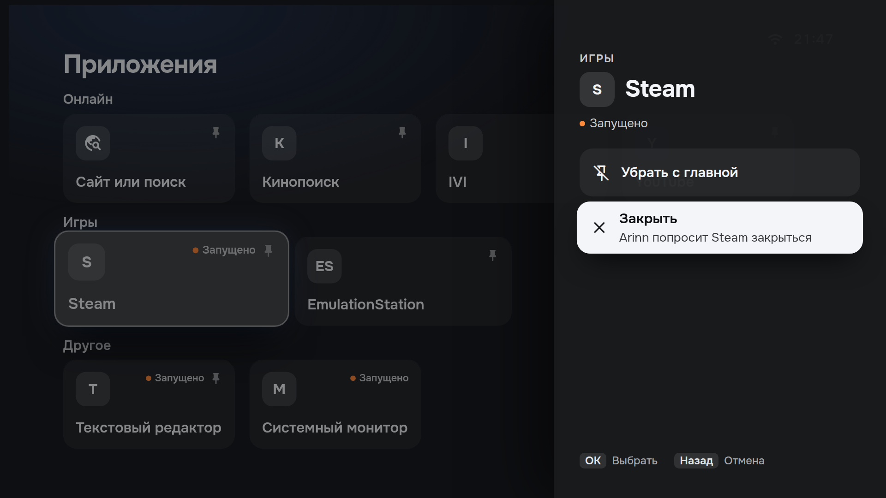
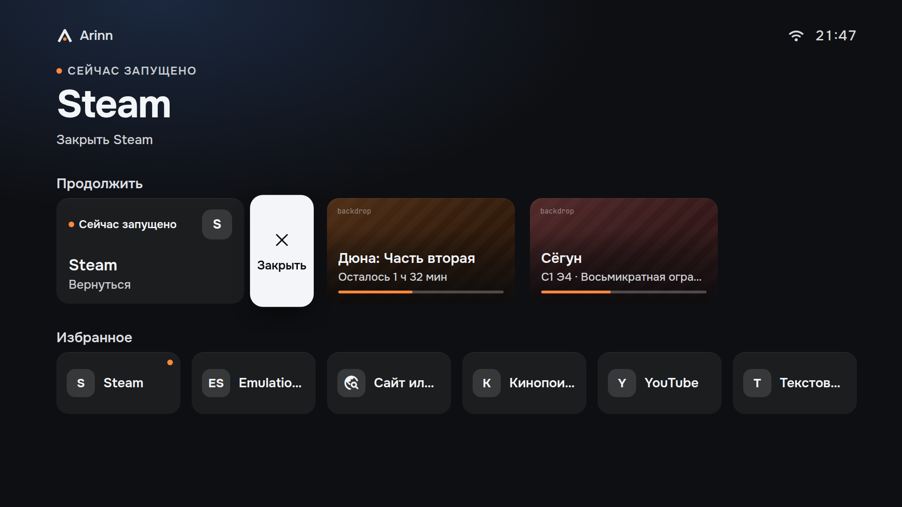
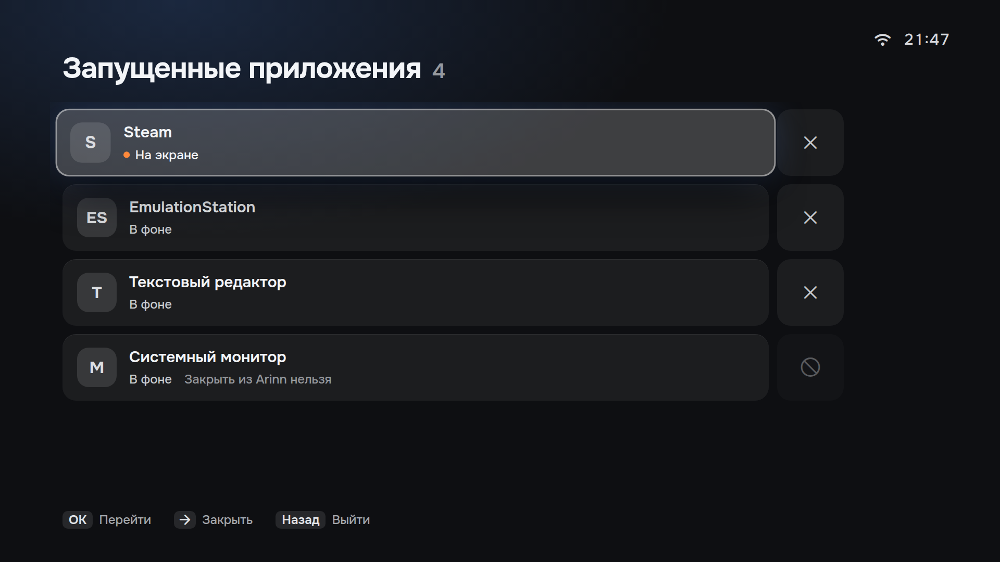
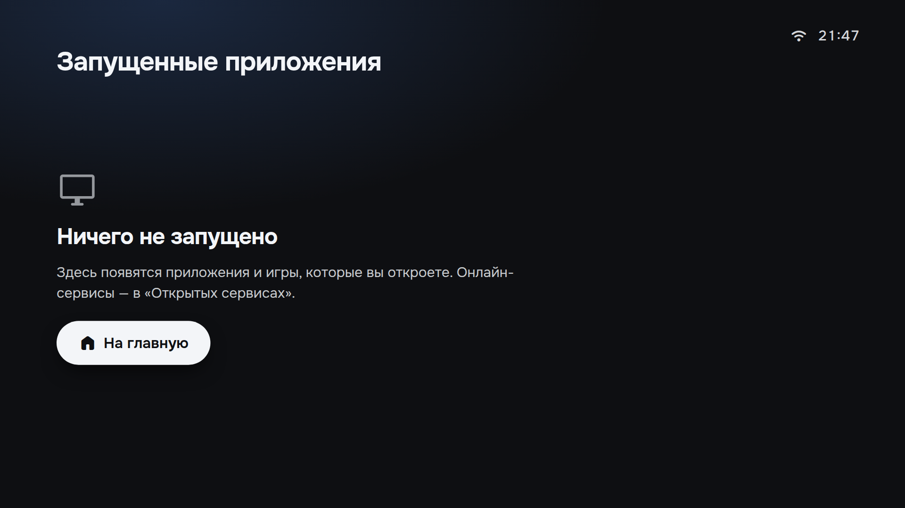
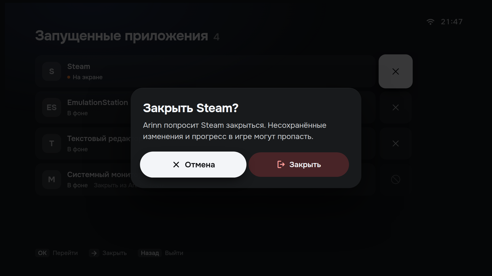
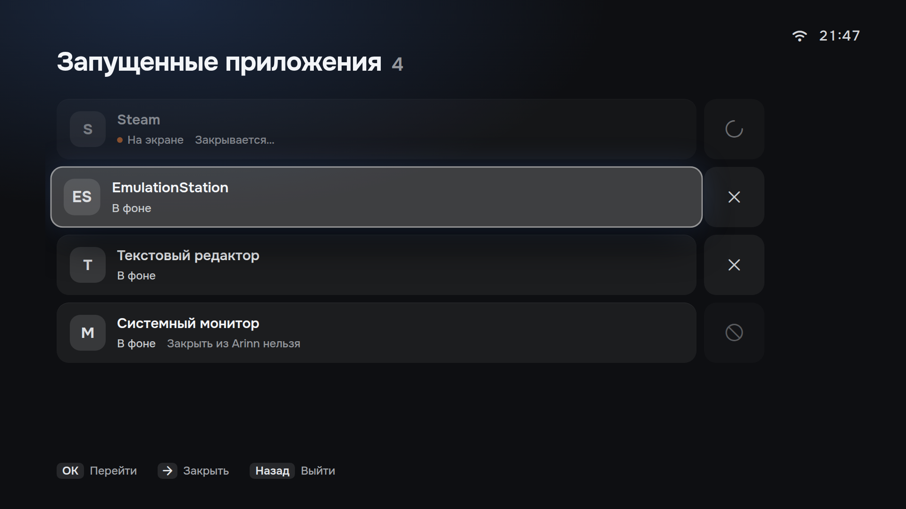
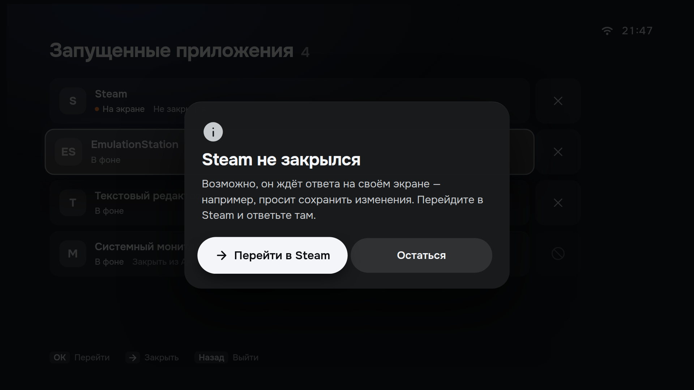
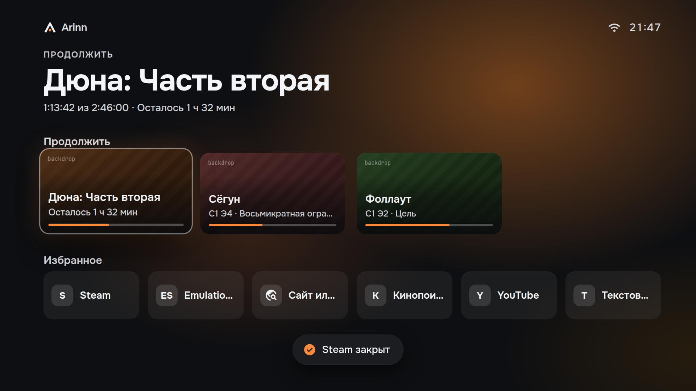

<!-- SPDX-FileCopyrightText: 2026 Arinn contributors -->
<!-- SPDX-License-Identifier: CC-BY-SA-4.0 -->

# Design brief: closing running applications

A brief for the designer, prepared from the owner decisions in [issue #205](https://github.com/LimeBeck/arinn/issues/205). It plays the same role as the earlier briefs that came back as the *Open services*, *Address and search* and *Settings editors* handoffs ([design README](../../README.md)): the owner passes it to the designer, and the answer returns as a handoff package.

**Status:** draft by an agent, not a design handoff. The frames are proposals built only from existing handoff components. Every item marked *recommendation* or *variant* is open until the owner or the designer decides it. Nothing in [`handoff/`](../../handoff/README.md) or `archive/` was changed.

## Package

| File | Content |
| --- | --- |
| [Closing Apps canvas](<arinn Closing Apps.dc.html>) | The brief in the handoff `.dc.html` format: owner decisions, open questions with recommendations, frames CL-1…12 with captions, rules carried over, and the handoff checklist. Russian UI strings, English notes. |
| `support.js` | An unchanged copy of the handoff runtime (`handoff/design/support.js`), so the canvas opens from this folder. |
| [`screenshots/`](screenshots/) | 1920×1080 renders of the 13 frames (`cl-*.png`). |

Open the canvas in a browser next to `support.js`. Add `#only=CL-4` (any frame ID) to the address to render one frame at full 1920×1080 size. As with the handoff files, fonts and the React runtime load from the network.

## Purpose

Let the user close a running ordinary application (Steam, a game, ES-DE, a desktop application) from the TV, safely, with the D-pad only.

Non-goals:

- **Browser services stay as they are.** Web services keep closing on *Open services* without confirmation ([ADR-0050](../../../adr/0050-window-per-browser-activity.md), frames OS-2 and OS-3). This brief does not change that screen.
- **No force kill.** Arinn asks the application to close and never kills a process ([specification §7.2](../../../specifications/arinn-specification.md#72-applications-steam-and-es-de)). There is no "force close" button in the MVP.
- No QML implementation and no specification change. Both follow the returned handoff and the owner's answers.

## Owner decisions (2026-10-01, recorded in the issue)

1. A running application can be closed from **three places**:
    - the **tile menu**: Menu on a running app tile (Apps screen and Home favorites) opens an action sheet with *Close* next to the existing pin/unpin;
    - the **Continue card** "Running now" on Home, with its own close action;
    - a **running list**: a separate screen with every running application, each with a close button, like *Open services*.
2. Closing **asks for confirmation** in the style of the power confirm, for example "Close Steam?" with the focus on *Cancel*, because a game or unsaved work can be lost.
3. Closing is a **graceful close only** (`Application1.Terminate`).

## Facts the design must respect

These come from the current contracts and implementation. They are inputs for the designer, not choices.

- `Terminate` is a control operation with a 5-second budget. It completes when the close request is delivered, not when the application has exited ([plugin API](../../../plugin-api/README.md), [desktop provider](../../../architecture/desktop-provider.md)). Arinn sees that an application closed when its running instance disappears. The application may also ignore the request, refuse it, or ask its own "save changes?" question; the operation can also fail as unsupported or time out. The design therefore needs a *closing* state, a *closed* state and a *did not close* state.
- Each running window is reported as a separate instance with its own `terminate` capability flag. An instance may not be closable by Arinn at all.
- Instance titles come from the application catalogue, never from the window, so two windows of one application have the same name.
- Spec §6.2 currently binds long-press Menu in Applications to pin/unpin, and Menu elsewhere to global navigation. The shell opens the web-shortcut editor with Menu on a shortcut tile ([#68](https://github.com/LimeBeck/arinn/issues/68), [web shortcuts UI](../../../architecture/ui-web-shortcuts.md)). Favorites pin/unpin has no public contract yet.
- Home's Continue section shows at most one running activity card ([specification §5.1](../../../specifications/arinn-specification.md#51-home)). When the activity card's application closes and another application still runs, the card shows that application instead.

## Screens and states to design

The frame IDs `CL-n` belong to this brief only. They do not extend the handoff numbering, and the designer may renumber. References use the handoff's own labels: canvas item numbers from `arinn Screens.dc.html` and the handoff README (13 Apps, 15 Power, 15b power confirm, 10/11 sheets, 18b browser failed dialog), whose screenshot files are numbered sequentially (`14-apps.jpg`, `17-power-confirm.jpg`), and frame IDs from the *Open services* (OS-1…7, H-1…6) and *Settings editors* (LF-1…8) canvases.

| ID | State | Built from | Screenshot |
| --- | --- | --- | --- |
| CL-1 | Tile sheet for a running app (Apps): pin/unpin and Close | Apps 13, sheet 10/11 | [cl-1](screenshots/cl-1-tile-sheet-running.png) |
| CL-2 | Tile sheet for a non-running app (Home favorites): pin/unpin only | Home 01, sheet 10/11 | [cl-2](screenshots/cl-2-tile-sheet-not-running.png) |
| CL-3a | Continue card: → moves to a Close button next to the card (*variant a*) | Activity card 03, close button OS-2 | [cl-3a](screenshots/cl-3a-continue-close-button.png) |
| CL-3b | Continue card: Menu opens the tile sheet (*variant b*) | Activity card 03, sheet 10/11 | [cl-3b](screenshots/cl-3b-continue-menu-sheet.png) |
| CL-4 | Running list, focus on a row; one row that Arinn cannot close | OS-1, LF-5 | [cl-4](screenshots/cl-4-running-list.png) |
| CL-5 | Running list, focus on Close | OS-2 | [cl-5](screenshots/cl-5-close-focus.png) |
| CL-6 | Running list, nothing running | OS-6 | [cl-6](screenshots/cl-6-nothing-running.png) |
| CL-7 | Entry from global navigation | Navigation 04, H-2 | [cl-7](screenshots/cl-7-nav-entry.png) |
| CL-8 | Confirmation dialog | Power confirm 15b, LF-6 | [cl-8](screenshots/cl-8-confirm.png) |
| CL-9 | Closing in progress | OS-3 | [cl-9](screenshots/cl-9-closing.png) |
| CL-10 | Closed: the Continue card collapses, focus moves to the neighbour, toast | Home 03, toast | [cl-10](screenshots/cl-10-closed.png) |
| CL-11 | Did not close: suggest switching to the app | 18b, H-6 | [cl-11](screenshots/cl-11-did-not-close.png) |
| CL-12 | Running list merged with Open services (*variant, not recommended*) | OS-1 | [cl-12](screenshots/cl-12-merged-variant.png) |

Key frames:

 

 

 

 

The canvas carries the exact Russian strings, the captions with D-pad paths, and the focus target after each transition.

## Constraints

- **3 m readability** on the 1920×1080 canvas (×2 for 4K): nothing below 24, nothing an action depends on below 26.
- **D-pad only**: arrows, OK, Back and Home reach every state. Focus scopes stay dialog › power › sheet › nav › screen. After a row or card disappears, focus moves to the neighbour ([specification §6.1](../../../specifications/arinn-specification.md#61-focus)).
- **Russian labels about 30% longer** than English: buttons hug their content, application names ellipsize on one line.
- **Design System v2 tokens only**: plate, plate-focus, glass, text-1…3, the 22% error tint for the destructive action. Ember marks "running", never focus.
- **Reuse existing patterns**: the right sheet (10/11), the confirm dialog (15b, LF-6), the Open services row and close button (OS-1…3), the empty state (OS-6), the navigation item (H-2) and the toast. No new component types.
- **Neutral monograms**, no third-party logos. Production icons come from the application record ([ADR-0059](../../../adr/0059-application-icon-references.md)).

## Open questions

The recommendations are the agent's proposals, not decisions. *Needs owner* items change product behaviour or the specification and are decided by the owner ([ADR-0037](../../../adr/0037-agent-autonomy-and-owner-gated-decisions.md)). *Designer* items are layout choices.

| # | Question | Recommendation | Who decides |
| --- | --- | --- | --- |
| Q1 | Merge the running list with *Open services*, or keep a separate screen? | **Separate screen.** Each list keeps one close rule (services without confirmation, apps with it), ADR-0050 and the Open services design stay as decided, and the designer already reserved the Russian word for "running" for apps and games. CL-12 shows the merged option for comparison. | Needs owner |
| Q2 | How is the running list reached? | A navigation item directly below *Open services* that replaces the bottom activity row, as the Open services item already does for web services (CL-7). No second summary card in Continue: §5.1 defines only the browser "N more open" entry. Changes the navigation list in §5. | Needs owner |
| Q3 | How is Close reached from the Continue card? | **Variant a** (CL-3a): → moves to a Close button next to the card, as on Open services rows. Variant b (CL-3b) hides Close behind Menu. | Designer |
| Q4 | Which input opens the tile sheet? | The input that pins today (long-press Menu in Apps), also on Home favorites; the sheet replaces the direct pin toggle. Requires a §6.2 update. | Needs owner |
| Q5 | Do web-shortcut tiles and a web-service activity card get Close? | **No.** Browser services close only on *Open services*. Menu on a web-shortcut tile keeps opening its editor (#68), or the sheet gains *Edit shortcut*. | Needs owner |
| Q6 | Screen name, navigation label and sheet order | Screen "Running applications", short navigation label "Running" (the full title does not fit the 500 px panel next to a count); pin/unpin first, Close second, focus on the first. | Designer |
| Q7 | Feedback after a successful close | The row or card collapses (220 ms as OS-3) and a short toast "{name} closed" appears. | Designer |
| Q8 | *Did not close*: dialog or inline? | A dialog (CL-11) whose default action switches to the application; a second button keeps the user in Arinn. No retry and no force close in the MVP. | Designer |
| Q9 | Several windows of one application; instances Arinn cannot close | One row per window; a row without the terminate capability stays, with a dimmed but focusable button that explains itself in a toast (LF-5 pattern). | Designer |

## Acceptance checklist for the handoff package

- [ ] A `.dc.html` canvas in the handoff format with design answers to Q1–Q9 (or the owner's decisions where already made).
- [ ] Frames: tile sheet for running and non-running apps from Apps and Home; the chosen Continue close; running list with row focus, close focus, many rows with scroll position, long names, an instance that cannot be closed, two windows of one application, and the empty state; the navigation entry; confirmation; closing; closed in the list and on the card; did not close.
- [ ] Every frame on the 1920×1080 canvas with captions that state the D-pad path and the focus target after each transition.
- [ ] 1920×1080 PNG screenshots of every frame, neutral monograms only.
- [ ] Final Russian strings for every label, status, dialog and toast; an English toggle as in *Open services* is welcome.
- [ ] Motion for the sheet, the closing spinner, the row and card collapse and the toast, using existing durations unless stated.
- [ ] A README section in the handoff README style, with any remaining open questions listed explicitly.

## After the handoff returns

The new package is integrated like the earlier ones: added to `handoff/` with the previous package archived, reconciled in the [integration review](../../integration-review.md), and the owner's answers to the *Needs owner* questions recorded in the specification (navigation in §5, keys in §6.2) and, if architectural, an ADR. Implementation follows as separate tasks.

## Regenerating the screenshots

From this folder, with Google Chrome and network access:

```sh
for id in CL-1 CL-2 CL-3a CL-3b CL-4 CL-5 CL-6 CL-7 CL-8 CL-9 CL-10 CL-11 CL-12; do
  google-chrome --headless=new --hide-scrollbars --user-data-dir="/tmp/chrome-$id" \
    --window-size=1920,1080 --virtual-time-budget=15000 \
    --screenshot="screenshots/$id.png" "file://$PWD/arinn%20Closing%20Apps.dc.html#only=$id"
done
```

The committed files carry descriptive names (`cl-4-running-list.png` and so on); rename the output to match. Chrome can stay running after writing the file when it has no D-Bus session; the screenshot is complete once the file is written.
