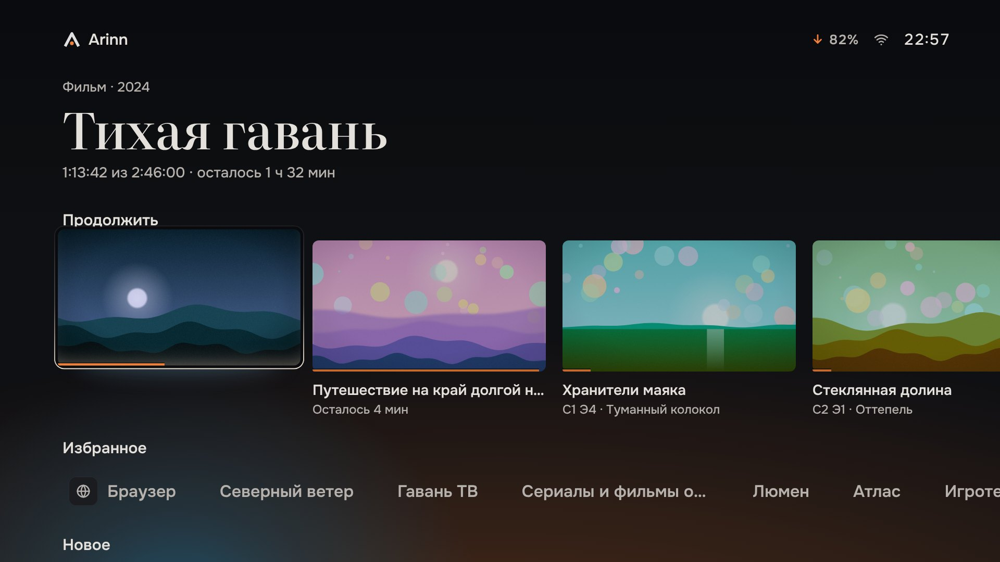
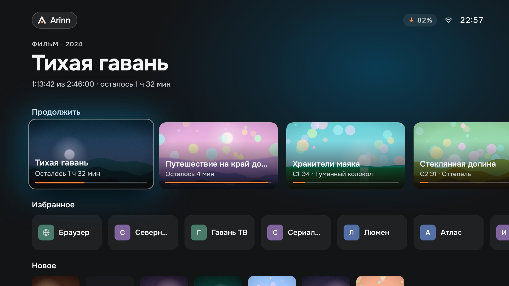
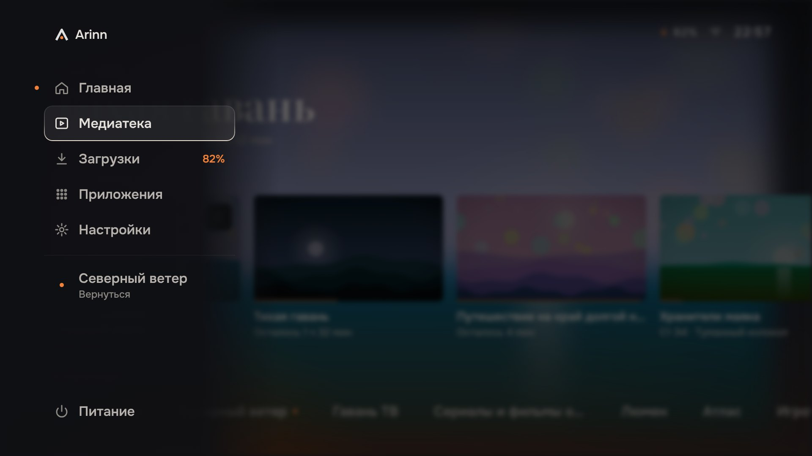
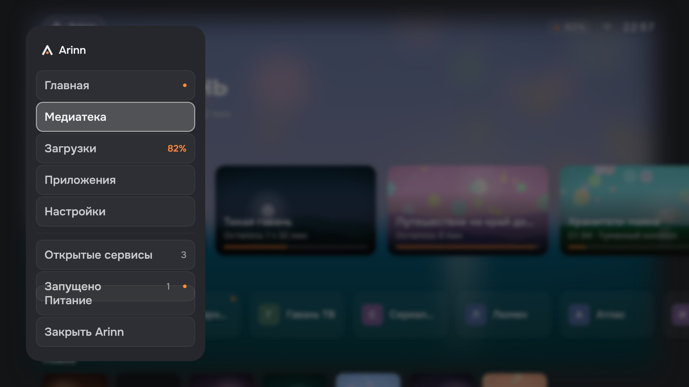
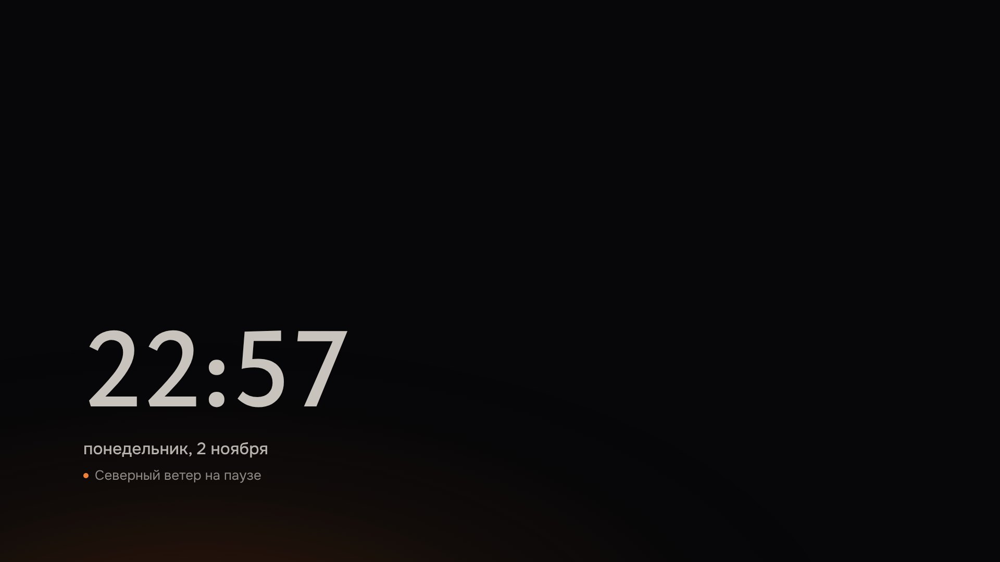
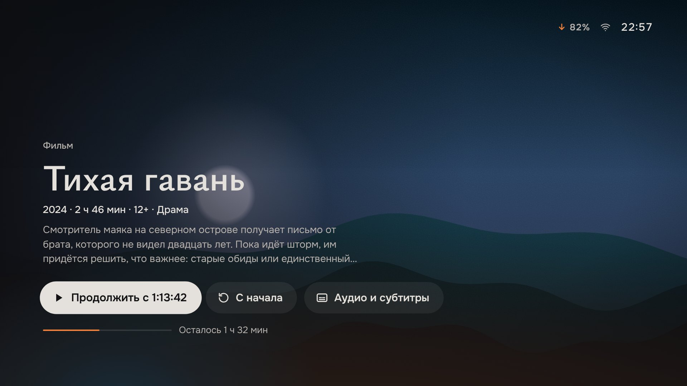

<!-- SPDX-FileCopyrightText: 2026 Arinn contributors -->
<!-- SPDX-License-Identifier: CC-BY-SA-4.0 -->

# Hearth light prototype

The interactive answer to the [Hearth light brief](../../briefs/hearth-light/README.md) ([#721](https://github.com/LimeBeck/arinn/issues/721)). It shows the proposed visual direction next to the current look, with synthesised interface sounds. It is a design reference: it does not change the shell, the specification or the historical handoff, and it decides nothing the brief leaves to the owner.

Serve the repository root, then open the prototype:

```sh
python -m http.server 8765 --bind 127.0.0.1
```

[Open the prototype](http://127.0.0.1:8765/docs/design/prototypes/hearth-light/hearth-light.html). Onest loads from the repository. Literata and Source Serif 4 come from Google Fonts, so an internet connection is needed for the serif variants. Everything else is in the one HTML file: no framework, no samples, no images. The data includes the hard cases the owner's captures of the real shell showed (see *Field check* in the brief): a very long title, a long favourite name and a poster without artwork. Titles, services and artwork are synthetic: the artwork is generated abstract landscapes, the names are fictional, and nothing is launched or played.

## Controls

| Input | Action |
| --- | --- |
| Arrows | Move focus (spatial navigation as in the handoff) |
| Enter / Space | OK |
| Esc / Backspace | Back |
| M | Global navigation |
| H | Home, with the short ignition (kindle) |
| A | Ambient; any key wakes |
| S | Replay the startup ignition |
| D | Show or hide the review panel |
| Mouse | Hover moves focus, click is OK |

The prototype and its review panel are in Russian, like the handoff. The panel (top right) switches the variant, the time of day, the sound level, the light field, reduced motion, the placeholder artwork, the Applications layout, letters on the shelf and the caption in focus, jumps to any scene, and plays each interface sound on its own.

**Sound starts after the first key press or click**, because browsers do not allow audio before a user gesture. The sound of the first startup on page load is therefore silent; press S to hear the ignition.

## URL parameters

| Parameter | Values | Default |
| --- | --- | --- |
| `variant` | `hearth` (A), `hearth-source` (A′), `hearth-sans` (B), `calm` (C), `current` | `hearth` |
| `scene` | `home`, `home-shelf`, `home-new`, `home-long`, `running`, `nav`, `library`, `detail`, `episodes`, `apps`, `player`, `ambient`, `startup` | `home` |
| `time` | `auto`, `day`, `evening`, `night` | `auto` (by the clock) |
| `sound` | `quiet`, `normal`, `off` | `quiet` |
| `light` | `off` turns the light field off | on |
| `motion` | `reduced` | full |
| `art` | `mixed`, `dark`, `bright`: placeholder artwork | `mixed` |
| `apps` | `lit`, `tiles`, `shelf`: Applications layout (Hearth light only) | `lit` |
| `chips` | `icons`, `letters`: letter monograms on the shelf (Hearth light only) | `icons` |
| `cap` | `hide`, `show`: caption of the focused Continue card (Hearth light only) | `hide` |
| `clock` | `live` uses the real time instead of the fixed 22:57 | fixed |
| `hud` | `0` hides the review panel (used for the screenshots) | shown |
| `hold` | `1` keeps the player's on-screen display from hiding | hides after 4 s |
| `paused` | `1` opens the player paused | playing |
| `item` | A title key for `scene=detail` or `scene=episodes`: `keepers` (series with stills), `valley` (series without stills), `voyage` (long title) | `harbor` / `keepers` |

For example: `hearth-light.html?scene=home&variant=current` shows the current look, and `?scene=ambient&time=night` shows Ambient at night.

## What to look at

1. **Home, A against Current.** Switch the variant with focus on the same card. Look at the plates, the uppercase eyebrow, the pastel monograms and the glow disappearing, and at the floor light, the rim and the serif title appearing.
2. **Move along a row.** The pool of light follows focus along the floor with a delay. The focused row is lit and the other rows recede. Switch the artwork option to bright: the mat keeps the focus visible on light artwork.
3. **Favourites as a shelf.** Press ↓ twice from Continue.
4. **A series.** Open the third Continue card (or `scene=detail&item=keepers`) and press ↓ twice: the selected season, then the current episode. `item=valley` shows episodes without stills as numbered title cards.
5. **A running application.** Use the *over an app* scene (`scene=running`). The application recedes behind Home and comes closer when its card has focus.
6. **Navigation** (M): an edge panel instead of a floating card.
7. **Player.** Enter on a card, then Enter on *Continue*. While it plays, navigation is silent. Pause it with OK, and the sounds come back.
8. **Ambient** (A) and the **time of day**: evening and night darken the room.
9. **Startup** (S): ignition from the Ember dot. Then press H anywhere: the short version, *kindle*, marks Arinn coming back.
10. **Sound.** Listen at the TV's normal level, from the sofa. *Quiet* is the proposed default.

## Videos

1280 × 720 recordings of the prototype in headless Chromium (no sound: the recordings capture the picture only):

| File | What it shows |
| --- | --- |
| [home.mp4](video/home.mp4) | The startup ignition, moving along the rows with the pool following focus, the shelf, the left-edge fade and the short ignition on H |
| [tour.mp4](video/tour.mp4) | Navigation, Library, a film detail, the player, Ambient and waking from it |
| [series.mp4](video/series.mp4) | A series detail: the season rail, the current episode, Back to the action, Home and a long title |

## Screenshots

1920 × 1080 Chromium captures of the second-round prototype with the review panel hidden, mixed placeholder artwork, the clock fixed at 22:57 (evening) and quiet sound.

| Scene | Hearth light (A) |
| --- | --- |
| Home | [01-home](screenshots/01-home.jpg) |
| Home, focus on the favourites shelf | [02-home-shelf](screenshots/02-home-shelf.jpg) |
| Home over a running application | [03-home-running](screenshots/03-home-running.jpg) |
| Global navigation | [04-navigation](screenshots/04-navigation.jpg) |
| Library | [05-library](screenshots/05-library.jpg) |
| Detail | [06-detail](screenshots/06-detail.jpg) |
| Applications | [07-applications](screenshots/07-applications.jpg) |
| Player | [08-player](screenshots/08-player.jpg) |
| Ambient | [09-ambient](screenshots/09-ambient.jpg) |
| Startup, 1.2 s into the ignition | [10-startup](screenshots/10-startup.jpg) |
| Home at night | [11-home-night](screenshots/11-home-night.jpg) |
| Home, a long title in two lines | [12-home-long-title](screenshots/12-home-long-title.jpg) |
| New, a poster without artwork as a title card | [13-home-new-no-artwork](screenshots/13-home-new-no-artwork.jpg) |
| Detail, a long title | [14-detail-long-title](screenshots/14-detail-long-title.jpg) |
| Applications as shelves (D-9) | [15-applications-shelf](screenshots/15-applications-shelf.jpg) |
| Applications as plain tiles (D-9) | [16-applications-plain-tiles](screenshots/16-applications-plain-tiles.jpg) |
| Letters on the shelf and the focused caption shown (D-8, D-10) | [17-home-letters-and-caption](screenshots/17-home-letters-and-caption.jpg) |
| Dark placeholder artwork only | [18-home-dark-artwork](screenshots/18-home-dark-artwork.jpg) |
| Bright placeholder artwork only | [19-home-bright-artwork](screenshots/19-home-bright-artwork.jpg) |
| Series detail | [31-detail-series](screenshots/31-detail-series.jpg) |
| Season rail, current episode in focus | [32-episodes](screenshots/32-episodes.jpg) |
| Episodes without stills as numbered title cards | [33-episodes-title-cards](screenshots/33-episodes-title-cards.jpg) |
| Continue scrolled: the previous card fades at the left edge | [34-home-left-edge](screenshots/34-home-left-edge.jpg) |

 

 

 

### Variants and the current look

| Variant | Home | Other |
| --- | --- | --- |
| Current (the shell today, approximated) | [20-home-current](screenshots/20-home-current.jpg) | [24-navigation-current](screenshots/24-navigation-current.jpg), [25-applications-current](screenshots/25-applications-current.jpg), [26-home-long-title-current](screenshots/26-home-long-title-current.jpg) |
| C · Calm | [21-home-calm](screenshots/21-home-calm.jpg) | — |
| B · Hearth light, sans | [22-home-hearth-sans](screenshots/22-home-hearth-sans.jpg) | — |
| A′ · Hearth light, Source Serif 4 | [23-home-hearth-source](screenshots/23-home-hearth-source.jpg) | — |

*Current* reproduces the shell's tokens (`Theme.qml`, `UiText.qml`) and the handoff's layout closely enough to compare. It is not a pixel copy of the Qt render; the [Qt captures](../../current-ui/README.md) are the reference for that.

## Verification

- All scenes were opened in headless Chromium (Playwright) at 1920 × 1080 and captured with no console errors or page errors.
- Scripted remote paths were replayed with the key log checked: Home → detail → player and back, navigation to Library and Applications, the series rail (selected tab, current episode, season switch, Back to the action), Ambient and Startup.
- Every interface sound was rendered offline with the prototype's own synthesis (`OfflineAudioContext`, 48 kHz). Measured peak and length: tap 0.22 / 49 ms, edge 0.25 / 69 ms, select 0.24 / 203 ms, back 0.10 / 135 ms, open 0.05 / 137 ms, close 0.07 / 128 ms, ignite 0.20 / 1.7 s, kindle 0.15 / 456 ms, error 0.16 / 277 ms. The media guard was checked: the player reports media playing, so interface sounds are suppressed.
- **Not tested:** listening on real speakers or a TV, readability of the rim and the serif at 3 m, and performance on HTPC hardware. These need the owner (brief, decision D-7).
