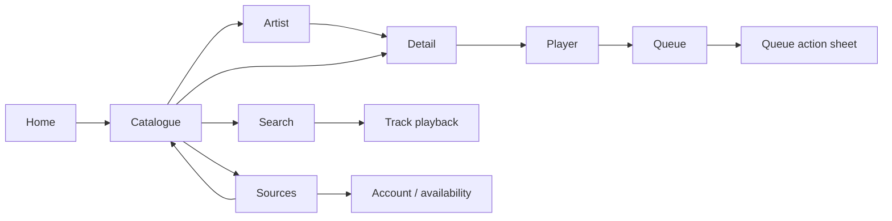

# Music visual prototype

**Superseded on 2026-11-06:** this prototype no longer defines the target. The [music Hearth light brief](../../briefs/music-hearth-light/README.md) does ([ADR-0142](../../../adr/0142-music-in-hearth-light.md)). It stays as the record of the earlier design.

Proposed visual design for [#677](https://github.com/LimeBeck/arinn/issues/677),
delivery task [#707](https://github.com/LimeBeck/arinn/issues/707) and unified
[MR #710](https://github.com/LimeBeck/arinn/pull/710). Design task #698 and
PR #700 were consolidated here at the owner's request on 2026-11-02. Based on the
[music design brief](../../music-design-brief.md) and
[provider research](../../../architecture/music-discovery.md). Owner visual
acceptance is pending. This is a standalone HTML/CSS/JS design artifact; it
changes no production shell, provider, wire contract or historical handoff.

## Open and edit

Serve the repository root locally:

```sh
python -m http.server 8765 --bind 127.0.0.1
```

[Open the prototype](http://127.0.0.1:8765/docs/design/prototypes/music/index.html).
Click inside to take focus. Use arrow keys and Enter, Escape/Backspace for Back,
and H for Home. Tab also works; sheets/dialogs trap it. Text search accepts a
physical keyboard or the prototype's simple letter keyboard. Source selection,
artists/albums/playlists/tracks, detail, player and queue are interactive.
Provider-owned personal selections, track-seeded radio, station pins and feedback
are explored in explicitly labelled radio review scenes.

The page loads the repository's Onest font and local assets only. No CDN,
external artwork, audio, network account requests, file scans or browser storage
are used. Everything is synthetic. The review toolbar labels this explicitly;
`?controls=0` hides that toolbar for captures. Demo playback is state only,
not actual media support. Blocked online sources do not become playable demos.

Edit `music.css` for presentation and `music.js` for fixtures/interactions. The
1920×1080 stage scales uniformly to the viewport, including 3840×2160, preserving
the existing shell palette, typography, safe margins, radii and focus treatment.
Abstract CSS artwork is original placeholder material, not provider branding.
Service attribution/branding still needs provider-specific review before release.

## Screen and state map



Detail selection does not play. Play starts a synthetic local session. Opening
Home or browsing another source preserves it; the compact player always names
its own source. Replacing a playing album asks for confirmation with Cancel
focused first. Back restores the opener when returning from detail or a sheet.
Search results retain original track identity rather than their filtered index.
Queue selection offers play, move earlier and remove in the local fixture.
Queue entries retain album identity and unique occurrence keys, including when
tracks from another local album are added. Next/Previous follow the edited queue.

Transport, queue and player feedback use original inline SVG icons with accessible
names and focus tooltips; Play/Pause updates its name/icon with session state,
and feedback exposes `aria-pressed`. No external icon font is loaded. The
full player keeps transport, queue, seek, feedback and track radio in one
horizontal row, with separators between groups; the 1080p/4K browser checks
verify alignment and that all controls fit the information column. The
`home-card` and `home-card-paused` scenes show a proposed 400×225 Continue card
matching the current Home row geometry: track/artist, source/station, playing or
paused status, and a separate icon transport action. Opening the card preserves
the same session and queue. The Home projection is design only, not production
daemon/Activity integration. The full-screen music mini-player is hidden on Home
to avoid duplicating that card's controls.

The review scene selector and `?scene=NAME` deep links cover:

| Scenes | Review purpose |
| --- | --- |
| `catalogue`, `sources`, `detail`, `search` | Normal browse and source selection |
| `player`, `queue`, `home`, `replace` | Live demo session, queue, Home and replacement confirmation |
| `account`, `pending`, `cancelled`, `expired`, `subscription` | Account and access states; no real login is attempted |
| `loading`, `empty`, `no-results`, `scanning` | Initial and incomplete catalogue states |
| `missing-art`, `metadata` | Absent artwork and unknown tags |
| `offline`, `unreadable`, `codec` | Local availability failures |
| `restricted`, `preview`, `no-device`, `rate`, `unavailable`, `restart`, `stale` | Capability, session and service failures |

### Personal selections and radio

After the owner's [CloudMus](https://github.com/cloudmus/cloudmus) comparison,
the prototype includes a source landing for My Wave and finite personal
playlists, and a separate YouTube personal-mix scene. Use the review selector or
append `?scene=yandex-wave`, `?scene=youtube-mixes` or `?scene=track-radio`.
These are labelled synthetic fixtures; ordinary source selection still shows
availability blockers. No service radio, login or account feedback is implemented.

- Listen starts the chosen fixture; a daily playlist is finite, distinct from
  an endless station. Pin/unpin affects only the current preview.
- Track actions start a seeded station. Replacing a session requires confirmation
  with Cancel focused first.
- The radio player displays its station and separate Like / Not for me actions.
  They are local fixture state, not account sync. Dislike keeps the playing track
  and replaces upcoming recommendations. `feedback-loading` and `feedback-error`
  illustrate pending/cancel and failure/retry without optimistic success.
- A low buffer triggers asynchronous synthetic replenishment. Stopped or
  superseded sessions discard late batches. The queue trims old entries and
  restores focus by entry identity; fixture track storage and event history are
  bounded too. This does not qualify a production streaming backend.
- `radio-player`, `radio-queue`, `radio-loading`, `radio-error` and `radio-empty`
  cover feedback, the loaded window, pending refill, failure and an exhausted
  buffer. Retry keeps the station. A station has no fictional total length.
  Whole-queue shuffle/repeat and generated-entry edit controls are not offered.

These are review scenes, not a model of every actual service. Recovery buttons
reset the synthetic scene or open an explanation; they cannot repair accounts,
files or service permission. Seek is illustrated, not a real transport command.
Queue persistence, playlist editing/import and device selection remain
design/contract questions. Yandex device-code sign-in is an explicit owner
requirement, recorded in the [backend plan](../../../architecture/music-backends.md#required-connection-flow),
and is not implemented by this prototype. Other providers need separately
qualified authentication flows. No mixed-source playback is promised.

## Captures

[Three player-control layouts and evaluation](control-layouts.md) compare the
linear row, centered transport with balanced side groups, and a minimal row with
More. The scenes are `controls-inline`, `controls-balanced` and
`controls-minimal`. The owner selected balanced groups (B) on 2026-11-01;
this is now the default player layout. A and C remain comparison scenes only.

| Screen | 1080p | 4K |
| --- | --- | --- |
| Catalogue | [Preview](screenshots/catalogue-1080.png) | [Preview](screenshots/catalogue-2160.png) |
| Sources | [Preview](screenshots/sources-1080.png) | — |
| Album | [Preview](screenshots/detail-1080.png) | — |
| Player | [Preview](screenshots/player-1080.png) | [Preview](screenshots/player-2160.png) |
| Queue | [Preview](screenshots/queue-1080.png) | — |
| Missing root | [Preview](screenshots/offline-1080.png) | — |
| Replace queue | [Preview](screenshots/replace-1080.png) | — |
| My Wave and selections | [Preview](screenshots/yandex-wave-1080.png) | [Preview](screenshots/yandex-wave-2160.png) |
| YouTube personal mixes | [Preview](screenshots/youtube-mixes-1080.png) | — |
| Radio player and feedback | [Preview](screenshots/radio-player-1080.png) | [Preview](screenshots/radio-player-2160.png) |
| Continuous queue | [Preview](screenshots/radio-queue-1080.png) | — |
| Replenishment | [Preview](screenshots/radio-loading-1080.png) | — |
| Refill error / retry | [Preview](screenshots/radio-error-1080.png) | — |
| Exhausted radio buffer | [Preview](screenshots/radio-empty-1080.png) | — |
| Feedback pending | [Preview](screenshots/feedback-loading-1080.png) | — |
| Feedback failed | [Preview](screenshots/feedback-error-1080.png) | — |
| Home card · playing | [Card preview](screenshots/home-card-1080.png) | — |
| Home card · paused | [Card preview](screenshots/home-card-paused-1080.png) | — |

Captures are Chromium renders of this prototype, not production QML screenshots.
Visual review inspected catalogue and player at 1080p. Uniform 4K rendering is
captured, but target-TV readability and real-remote acceptance are not tested.

## Verification

Requires Python Playwright and Chromium; no desktop session or service account:

```sh
python docs/design/prototypes/music/verify.py --capture
node --check docs/design/prototypes/music/music.js
```

The verifier starts a loopback-only server, checks detail without autoplay,
filtered-track identity, source/session isolation, queue edits, keyboard/sheet
focus, safe Cancel, Home return, all 44 direct scenes and absence of external
asset requests. `--capture` regenerates the captures. Override `--chromium` if
the Chromium executable is elsewhere. This is not an operator test.

Initial verification: local HTTP binding was denied by the sandbox; the verifier
ran with loopback/network permission. The first run then failed because its
assertion incorrectly required a single h1 across both screen and detail titles;
the assertion now checks the screen header specifically. A later cross-album
test initially timed out because it tried to Back from a deep-link detail to a
catalogue it had never opened; it now enters through the catalogue. Independent
review found blocked-source search, edited-queue transport, input-blur click,
playlist-title and cross-album identity bugs; each was fixed and covered by a
browser regression case. The full rerun passed.
This history does not imply a clean initial run or production acceptance.

Radio checks cover finite/radio distinction, station pins, track seeds, feedback,
automatic refill, retry, bounded queue history and focus during background trim.
An early fixture-label assertion failed because uppercase rendered text was
compared case-sensitively; it now normalizes case. An intermediate syntax error
was caught by `node --check` and corrected. Independent review identified and
prompted fixes for focus during trimming and history growth during repeated
dislike/skip, with additional review scenes for exhausted-buffer and feedback
failure/pending coverage. See PR validation for subsequent full rerun results.

Icon/Home refinement verification checks the SVG controls' accessible names,
rating pressed states, synchronized Play/Pause names in both players, Home-card
transport and preserving paused state when opening the player from the card.

Owner review of these screens and scenarios is required before production UI
work. #677 remains open, and provider feasibility blockers remain unchanged.
