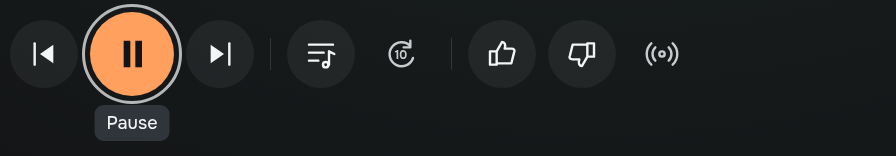
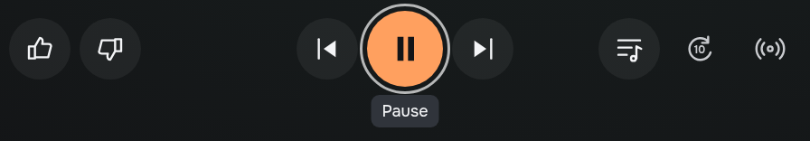
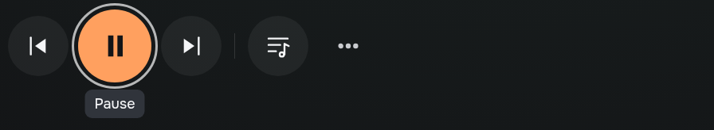

# Music player control layout comparison

Owner-requested alternatives for [#677](https://github.com/LimeBeck/arinn/issues/677),
design task [#698](https://github.com/LimeBeck/arinn/issues/698),
[PR #700](https://github.com/LimeBeck/arinn/pull/700). Proposed on 2026-11-01.
This is a design evaluation, not a user study or a change to the production
shell. The owner selected B on 2026-11-01. All alternatives retain one horizontal
primary-action row.

## Comparable variants

Open the [prototype](README.md#open-and-edit) and choose `controls-inline`,
`controls-balanced` or `controls-minimal` in the scene selector. All use the same
track, artwork, source, station and initial Pause focus. Keyboard and pointer
navigation, feedback, queue and the overflow sheet remain interactive.

### A — Linear row

Previous, Play/Pause, Next, Queue, Seek, Like, Dislike and Track radio are visible,
with thin separators. This is retained as a comparison scene.

It is direct and familiar, with no hidden actions. However, Pause sits near the
left edge and the row reads as a chain of eight actions. Feedback is far from
the starting focus, which is a disadvantage when skipping or rejecting music in
a personal station.

[1080p screen](screenshots/controls-inline-1080.png) ·
[4K screen](screenshots/controls-inline-2160.png)

### B — Balanced groups, centered transport

Like/Dislike sit on the left; Previous/Play-Pause/Next form the central group;
Queue/Seek/Track radio sit on the right. Pause is centered in the information
column, independent of the unequal button counts on the sides. All eight actions
remain visible, with the same 68 px secondary targets and 84 px primary target
as A at the logical 1080p stage.

This creates a clear transport anchor and keeps feedback close to it. The main
tradeoff is learning that feedback is on the left. Group spacing is wider, so
the implementation must preserve deterministic remote focus across the gaps.
Future capability-dependent empty groups need stable placement too; do not
spread the remaining buttons arbitrarily when an action is unsupported.

[1080p screen](screenshots/controls-balanced-1080.png) ·
[4K screen](screenshots/controls-balanced-2160.png)

### C — Minimal row with More

Previous, Play/Pause, Next, Queue and More remain visible. More opens a labelled
action sheet for feedback, Seek and Track radio. Secondary targets grow to 76 px
and the primary target to 92 px on the logical stage.

This is the quietest presentation and gives the largest targets. The cost is
hidden feedback and an extra focus scope; likes/dislikes lose both visibility
and immediate selected-state feedback in the main player. It is a reasonable
album-player alternative, but weaker for My Wave, where rejecting a track is a
frequent action. Escape closes the sheet and restores More; choosing an action
also restores the opener rather than jumping to the header.

[1080p screen](screenshots/controls-minimal-1080.png) ·
[4K screen](screenshots/controls-minimal-2160.png)

## Evaluation

| Criterion | A: linear | B: balanced | C: minimal |
| --- | --- | --- | --- |
| Visible actions | 8 | 8 | 5; 4 in More |
| Transport hierarchy | Pause prominent but left-weighted | Pause anchors the center | Largest Pause; little competition |
| Feedback discoverability | Visible, toward the far end | Visible, dedicated left group | Hidden; requires opening More |
| Dislike from initial Pause focus | 5 Right + Enter | 2 Left + Enter | 3 Right + Enter, Down + Enter |
| Queue from Pause | 2 Right + Enter | 2 Right + Enter | 2 Right + Enter |
| Focus scopes for feedback | Player only | Player only | Player plus action sheet |
| Main drawback | Long undifferentiated sequence | Left feedback needs a small learning step | Hides a frequent radio action |

The navigation counts describe the prototype's spatial keyboard model at 1080p
and 4K, with initial Pause focus and no intervening updates. They count key
presses, not elapsed time, reach effort or observed user performance. All three
fit their information column at both resolutions and keep a single centerline.
Actual remote and target-TV readability have not been qualified.

Recommendation: **B for the common player**, especially personal radio. It
preserves discoverability while reducing the path to Dislike from six key
presses to three. Next and Queue retain their short paths. Prefer C only if a
future reviewed scope prioritizes a minimal album player over immediate feedback;
A remains a valid conservative fallback. Do not expose three permanent layout
settings merely because alternatives are available for review.

The owner selected **B**, which is now the prototype default. A and C remain
review references rather than user settings. A production implementation would also choose a
single active transport surface rather than duplicate full-player and compact
transport; that existing prototype simplification is held constant here so it
does not bias this comparison.

## Evidence and limits

The browser verifier covers all 44 direct scenes plus variant-specific checks:
one-row alignment/fit at 1080p/4K, centered Pause in B, arrow paths to feedback,
opening/closing the More sheet, feedback from the sheet and returning from
track-radio actions without losing the More opener. Captures use original SVG
icons and synthetic content; there are no service/account/audio requests.
Readability and hierarchy judgements above are heuristic visual inspection,
not scores inferred from a measured usability study.
